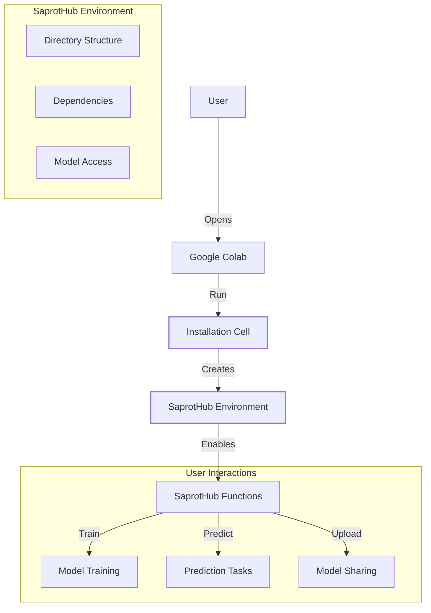
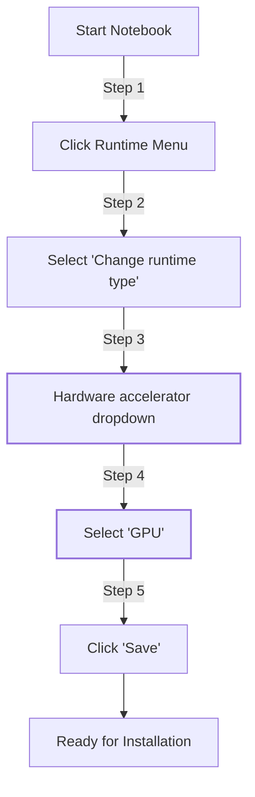
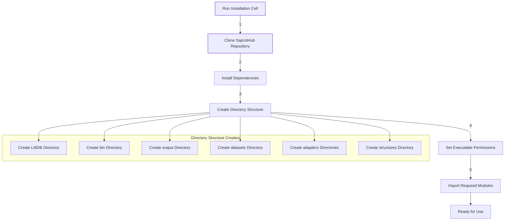
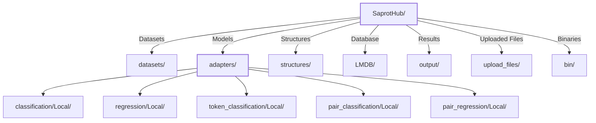
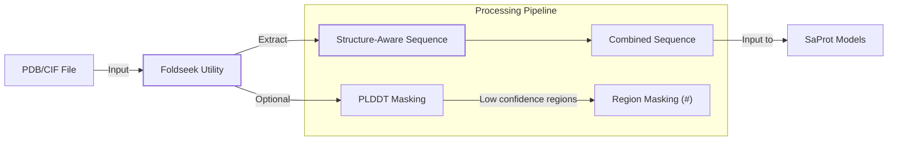
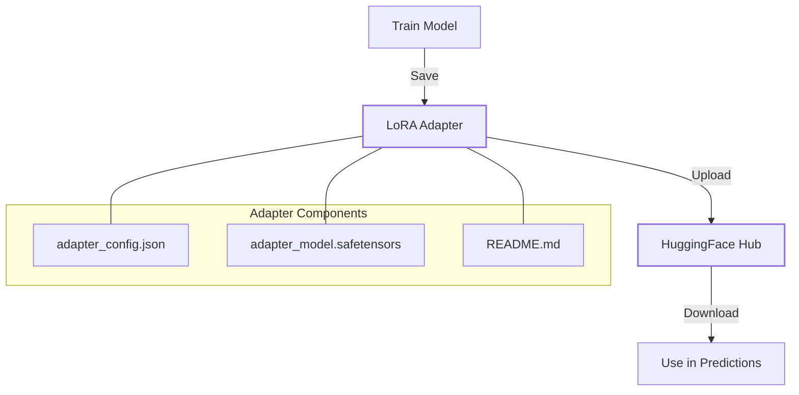
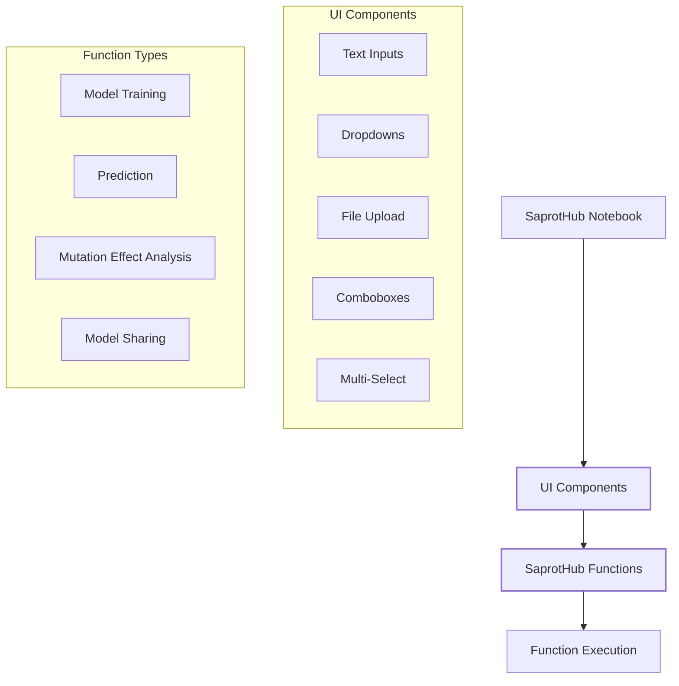

# Google Colab Deployment

Relevant source files

The following files were used as context for generating this wiki page:

- [Figure/training_curve_cls.png](Figure/training_curve_cls.png)
- [Figure/training_curve_reg.png](Figure/training_curve_reg.png)
- [colab/SaprotHub.ipynb](colab/SaprotHub.ipynb)
- [colab/SaprotHub_v2.ipynb](colab/SaprotHub_v2.ipynb)
- [saprot/utils/foldseek_util.py](saprot/utils/foldseek_util.py)

This page explains how to deploy and run SaprotHub in Google Colab, a cloud-based Jupyter notebook environment with free GPU access. This deployment option allows biologists and researchers to use protein language models without local high-performance computing resources. For local server deployment instructions, see [Local Server Deployment](#6.2).

## 1. Overview of Google Colab Deployment

SaprotHub provides a streamlined deployment through Google Colab notebooks that handle installation, environment setup, and GPU configuration automatically. These notebooks (`SaprotHub.ipynb` and the newer `SaprotHub_v2.ipynb`) serve as both the deployment mechanism and the user interface.

Sources: [colab/SaprotHub.ipynb:102-176](), [colab/SaprotHub_v2.ipynb:62-188]()

## 2. Getting Started with Colab Deployment

### 2.1 Accessing the Colab Notebook

Two versions of the SaprotHub Colab notebook are available:

- **SaprotHub v1**: Original version with all functionality
- **SaprotHub v2**: Newer version with a more user-friendly interface (recommended)

To access either notebook, visit the [SaprotHub GitHub repository](https://github.com/westlake-repl/SaprotHub) and click on the Colab links, or directly open the notebooks from the `/colab` directory.

### 2.2 Configuring GPU Runtime

Google Colab provides free GPU access, which is essential for running protein language models efficiently.

Sources: [colab/SaprotHub_v2.ipynb:36-53]()

### 2.3 GPU Selection Guide

Different protein modeling tasks require different levels of GPU resources:

| GPU Type | Availability | Suitable For | Limitations |
|----------|--------------|--------------|-------------|
| T4 | Free | Training small models (Saprot 35M), prediction tasks, mutational effect analysis | Unstable for long-running tasks, memory limitations |
| L4 | Requires Colab Pro | Training medium models (Saprot 650M) | Slower than A100 |
| A100 | Requires Colab Pro | Training large models, complex tasks | - |

Sources: [colab/SaprotHub_v2.ipynb:44-53]()

### 2.4 Installation Process

The installation process is automatically handled by running the first code cell in the notebook:

Sources: [colab/SaprotHub.ipynb:102-176](), [colab/SaprotHub_v2.ipynb:142-166]()

## 3. Directory Structure

During installation, SaprotHub creates the following directory structure:

Sources: [colab/SaprotHub.ipynb:242-250](), [colab/SaprotHub_v2.ipynb:258-266]()

## 4. Runtime Considerations

### 4.1 Session Limits

Google Colab has runtime limitations that affect long-running tasks:

| Plan | Maximum Runtime | Idle Timeout | Additional Features |
|------|----------------|--------------|---------------------|
| Free | 12 hours | Yes | - |
| Colab Pro | Based on availability | Yes | Increased compute availability |
| Pay As You Go | Based on availability | Yes | Increased compute availability |
| Colab Pro+ | Up to 24 hours | No | Background execution, continuous code execution |

Sources: [colab/SaprotHub.ipynb:81-99]()

### 4.2 Handling Interruptions

To prevent losing progress due to session timeouts:

1. Avoid letting your computer go to sleep during long-running tasks
2. Prevent the notebook from remaining idle for extended periods
3. Save model checkpoints regularly during training
4. For models trained in previous sessions, use the model loading functionality to resume work

### 4.3 Managing Resources

Google Colab provides limited memory resources. To optimize usage:

1. Use appropriate batch sizes based on your GPU type
2. Close other browser tabs to prevent browser crashes
3. Monitor memory usage during execution
4. Consider Parameter-Efficient Fine-Tuning (PEFT) to train large models with limited resources

## 5. Troubleshooting Colab Deployment

### 5.1 Common Issues

| Issue | Solution |
|-------|----------|
| Connection dropped | Reconnect and run the installation cell again |
| Out of memory error | Reduce batch size or use a more powerful GPU |
| Runtime reset | Check recent browser behavior that might trigger idle detection |
| Dependencies conflict | Clear all output and run the installation cell again |
| Version compatibility | Use the recommended notebook (v2) for latest fixes |

### 5.2 Reconnecting After Disruptions

When encountering connection issues:

1. Click the run button to stop the program
2. Wait for the button to change from dynamic to static state
3. Reconnect and restart by running the installation cell

Sources: [colab/SaprotHub_v2.ipynb:66-70]()

## 6. Integration with External Tools

### 6.1 FoldSeek Integration

SaprotHub integrates with FoldSeek for protein structure handling:

Sources: [saprot/utils/foldseek_util.py:11-87]()

### 6.2 HuggingFace Hub Integration

SaprotHub connects to HuggingFace Hub for model sharing and downloading:

Sources: [colab/SaprotHub.ipynb:347-407]()

## 7. User Interface Elements

The Colab notebooks provide various UI components for interacting with SaprotHub:

Sources: [colab/SaprotHub.ipynb:361-406](), [colab/SaprotHub_v2.ipynb:377-434]()

## 8. Deployment Versions

SaprotHub is evolving with improved deployment options:

| Version | File | Features | Status |
|---------|------|----------|--------|
| v1 | SaprotHub.ipynb | Original interface, full functionality | Will be deprecated |
| v2 | SaprotHub_v2.ipynb | More user-friendly interface, improved stability | Recommended |

The documentation recommends using v2 for a better user experience.

Sources: [colab/SaprotHub.ipynb:8-9](), [colab/SaprotHub_v2.ipynb:21-26]()

## 9. Browser Compatibility

SaprotHub in Google Colab works best with the Chrome browser. Safari may cause compatibility issues with some interface elements.

Sources: [colab/SaprotHub_v2.ipynb:21-26]()

---