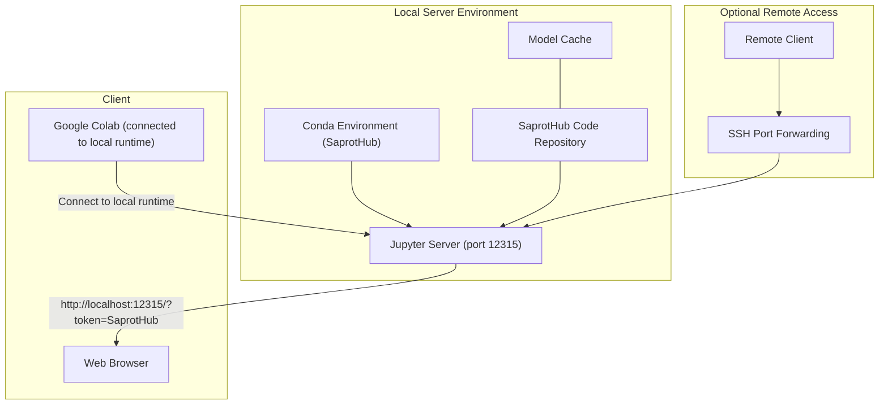
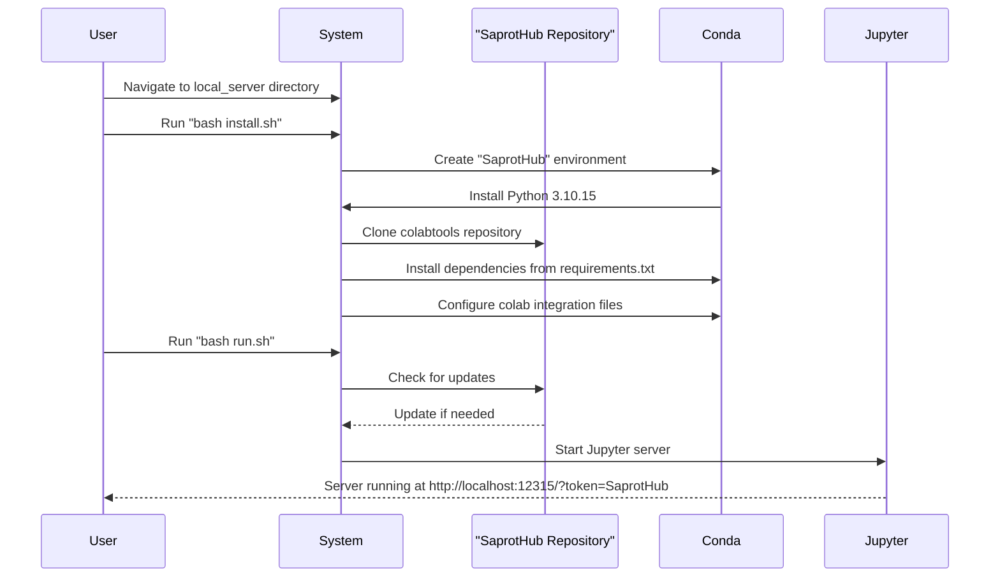
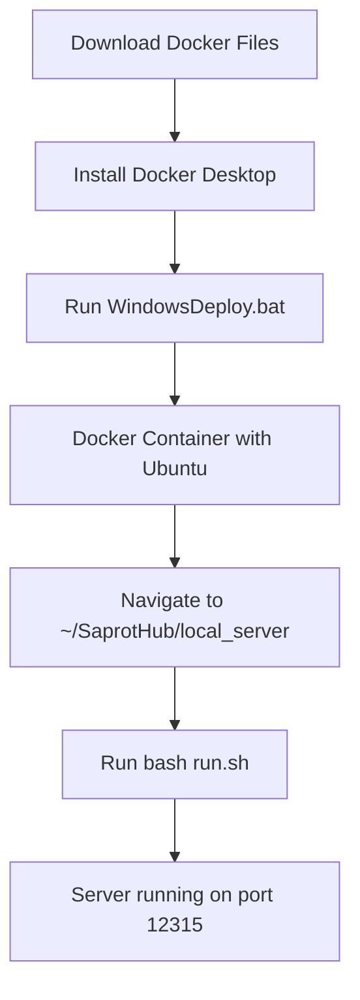
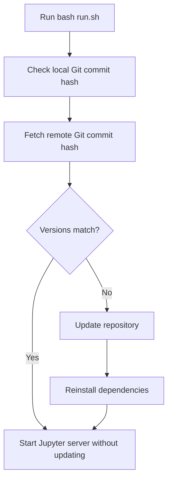
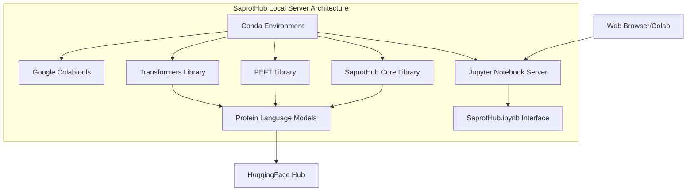

# Local Server Deployment

<details>
<summary>Relevant source files</summary>

The following files were used as context for generating this wiki page:

- [Figure/InstallPage1.png](Figure/InstallPage1.png)
- [Figure/InstallPage2.png](Figure/InstallPage2.png)
- [Figure/InstallPage3.png](Figure/InstallPage3.png)
- [local_server/README.md](local_server/README.md)
- [local_server/install.sh](local_server/install.sh)
- [local_server/requirements.txt](local_server/requirements.txt)
- [local_server/run.sh](local_server/run.sh)
- [requirements.txt](requirements.txt)

</details>


This page explains how to deploy SaprotHub on your local server or workstation. Local deployment provides advantages such as unrestricted computational time, direct access to your hardware resources, and improved data privacy. For cloud-based deployment options, see [Google Colab Deployment](#6.1).

## Deployment Overview

SaprotHub's local server deployment provides a self-hosted Jupyter notebook environment that mimics the Google Colab interface. Once deployed, you can connect to it using a browser and run the SaprotHub notebook interfaces with access to your local computing resources.



Sources: [local_server/README.md:45-58](), [local_server/run.sh:20-21]()

## System Requirements

Before deploying SaprotHub locally, ensure your system meets the following requirements:

| Component | Requirement |
|-----------|-------------|
| Operating System | Linux (recommended) or Windows with Docker |
| Python | 3.10+ (automatically installed via conda) |
| RAM | 8GB minimum, 16GB+ recommended |
| Storage | 10GB+ free space |
| GPU | Optional but recommended for model training |
| CUDA | Required if using GPU (compatible with PyTorch 2.0.1) |

Sources: [requirements.txt:1-24](), [local_server/requirements.txt:1-25]()

## Deployment Process

SaprotHub offers different deployment methods depending on your operating system.

### Linux Deployment

The Linux deployment process uses a conda environment and bash scripts to set up and run the server.



To deploy on Linux:

1. Clone the SaprotHub repository
2. Navigate to the local_server directory
   ```bash
   cd local_server
   ```
3. Run the installation script
   ```bash
   bash install.sh
   ```
4. Start the server
   ```bash
   bash run.sh
   ```

Sources: [local_server/README.md:4-15](), [local_server/install.sh:1-17](), [local_server/run.sh:1-21]()

### Windows Deployment

Windows deployment relies on Docker to provide a consistent environment.



To deploy on Windows:

1. Download `SaprotHubImage.tar` and `WindowsDeploy.bat` from [Hugging Face](https://huggingface.co/datasets/lxzcpro/SaprotHubWindowsDeploy/tree/main)
2. Install Docker Desktop and ensure it's running
3. Run `WindowsDeploy.bat`
4. In the Ubuntu bash shell that appears, run:
   ```bash
   cd ~/SaprotHub/local_server
   bash run.sh
   ```

Sources: [local_server/README.md:20-41]()

## Automatic Updates

The local server includes an automatic update mechanism that checks for new versions of SaprotHub when you start the server.



The update mechanism performs the following steps:
1. Compares the local Git commit hash with the remote repository
2. If they differ, performs a `git fetch` and `git reset --hard origin/main` followed by `git pull`
3. Reinstalls required packages with `pip install -r local_server/requirements.txt`
4. Uninstalls and reinstalls the `saprot` package

Sources: [local_server/run.sh:5-18]()

## Connecting to the Local Server

Once the server is running, you can connect to it in two ways:

### Direct Browser Connection

Open your web browser and navigate to:
```
http://localhost:12315/?token=SaprotHub
```

### Google Colab Connection

To use the Google Colab interface with your local server:

1. Open [SaprotHub.ipynb](https://colab.research.google.com/github/westlake-repl/SaprotHub/blob/main/colab/SaprotHub.ipynb) in your browser
2. Click "Connect to a local runtime" in the connection dropdown
3. Enter `http://localhost:12315/?token=SaprotHub` as the backend URL

Sources: [local_server/README.md:45-51]()

### Remote Access via SSH Port Forwarding

If your GPU server is remote, you can use SSH port forwarding to access it:

```bash
ssh -NL 12315:localhost:12315 user@remote_server
```

After establishing the SSH tunnel, connect to `http://localhost:12315/?token=SaprotHub` as if the server were local.

Sources: [local_server/README.md:53-58]()

## Technical Architecture

The local server deployment consists of several key components that work together to provide the SaprotHub functionality.



Sources: [local_server/requirements.txt:1-25](), [local_server/run.sh:1-21](), [local_server/install.sh:1-17]()

## Dependencies

The local server relies on several key Python packages:

| Package | Version | Purpose |
|---------|---------|---------|
| torch | 2.0.1 | Deep learning framework |
| transformers | 4.28.0 | Foundation for language models |
| peft | 0.10.0 | Parameter-Efficient Fine-Tuning |
| huggingface_hub | 0.23.2 | Model downloading and sharing |
| biopython | 1.83 | Biological sequence processing |
| lmdb | 1.4.1 | Efficient data storage |
| py3Dmol | 2.4.2 | Protein structure visualization |
| jupyter_ui_poll | - | Jupyter UI integration |

A conda environment is used to manage these dependencies, ensuring compatibility and isolation.

Sources: [local_server/requirements.txt:1-25](), [requirements.txt:1-24]()

## Troubleshooting

### Common Issues

| Issue | Possible Solution |
|-------|-------------------|
| Jupyter server fails to start | Check if port 12315 is already in use by another application |
| CUDA errors | Verify CUDA compatibility with PyTorch 2.0.1 |
| Connection refused | Ensure the Jupyter server is running and the port is accessible |
| Windows Docker fails | Make sure Docker Desktop is running before executing WindowsDeploy.bat |
| Package import errors | Try manually reinstalling the failed package with `pip install` |

### Reinstalling or Updating

If you encounter issues, you can force an update by:

1. Deleting the cached repository at `/root/.cache/SaprotHub/SaprotHub` (Linux)
2. Rerunning the installation script
3. Restarting the server

Sources: [local_server/run.sh:5-18](), [local_server/README.md:4-41]()

---