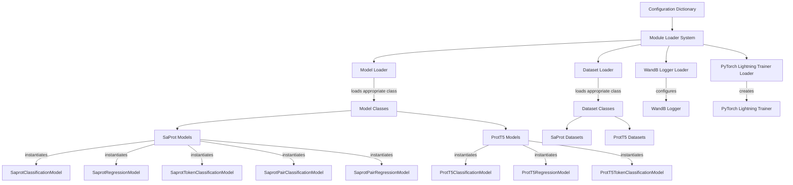
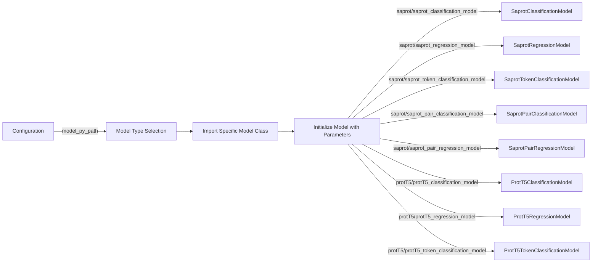
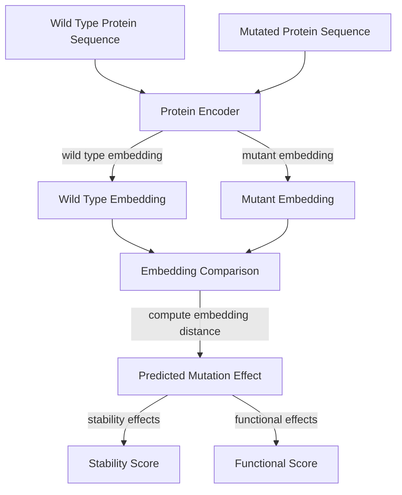
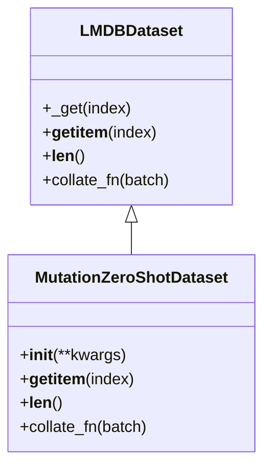
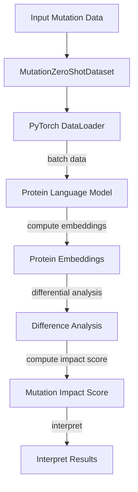
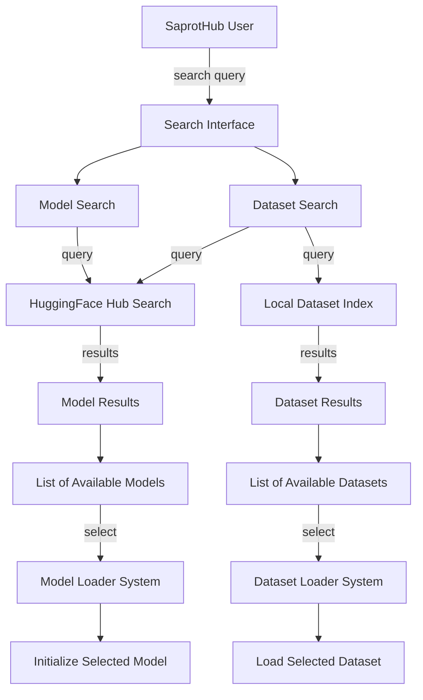
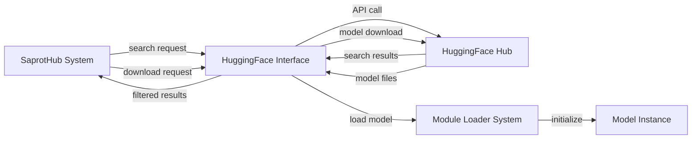

# Advanced Topics

<details>
<summary>Relevant source files</summary>

The following files were used as context for generating this wiki page:

- [saprot/dataset/mutation_zeroshot_dataset.py](saprot/dataset/mutation_zeroshot_dataset.py)
- [saprot/utils/module_loader.py](saprot/utils/module_loader.py)

</details>


This page covers advanced features and capabilities of the SaprotHub system that extend beyond the core functionality covered in previous sections. We explore three specialized topics: the dynamic module loading system, zero-shot mutation prediction capabilities, and search engine integration. These features are designed for users who want to leverage the full power of SaprotHub for specialized research applications.

For basic model training and usage, see [Model Architecture](#3) and [Training Pipeline](#5). For deployment options, see [Deployment Options](#6).

## 7.1 Module Loading System

SaprotHub implements a flexible dynamic module loading system that allows for runtime configuration and initialization of various components. This design enables users to select and configure different models and datasets without modifying the core codebase.

### Architecture



The module loading system centralizes component initialization and provides a standardized approach for loading different types of modules based on configuration parameters.

### Model Loading

The system dynamically loads model classes based on the specified model type in the configuration:



The `my_load_model` function in the module loader handles this dynamic loading process:

```python
def my_load_model(config):
    model_config = copy.deepcopy(config)
    model_type = model_config.pop("model_py_path")

    if "kwargs" in model_config.keys():
        kwargs = model_config.pop('kwargs')
    else:
        kwargs = {}
    
    model_config.update(kwargs)

    # Import and initialize specific model class based on model_type
    if model_type == "saprot/saprot_classification_model":
      from model.saprot.saprot_classification_model import SaprotClassificationModel
      return SaprotClassificationModel(**model_config)
    
    # ... additional model types
```

Sources: [saprot/utils/module_loader.py:15-58]()

### Dataset Loading

Similarly, datasets are loaded dynamically based on the dataset type specified in the configuration:

```python
def my_load_dataset(config):
    dataset_config = copy.deepcopy(config)
    dataset_type = dataset_config.pop("dataset_py_path")
    kwargs = dataset_config.pop('kwargs')
    dataset_config.update(kwargs)

    if dataset_type == "saprot/saprot_classification_dataset":
      from dataset.saprot.saprot_classification_dataset import SaprotClassificationDataset
      return SaprotClassificationDataset(**dataset_config)
    
    # ... additional dataset types
```

Sources: [saprot/utils/module_loader.py:64-101]()

### Trainer and Logger Integration

The module loader also handles the initialization of PyTorch Lightning trainers and WandB integration:

```python
def load_wandb(config):
    # initialize wandb
    wandb_config = config.setting.wandb_config
    wandb_logger = WandbLogger(project=wandb_config.project, config=config,
                               name=wandb_config.name,
                               settings=wandb.Settings())
    
    return wandb_logger

def load_trainer(config):
    trainer_config = copy.deepcopy(config.Trainer)
    
    # Initialize wandb
    if trainer_config.logger:
        trainer_config.logger = load_wandb(config)
    else:
        trainer_config.logger = False
    
    # Initialize strategy
    # strategy = load_strategy(trainer_config.pop('strategy'))
    # Strategy is not used in Colab
    trainer_config.pop('strategy')
    
    return pl.Trainer(**trainer_config, callbacks=[], use_distributed_sampler=False)
```

Sources: [saprot/utils/module_loader.py:103-187]()

## 7.2 Zero-Shot Mutation Prediction

SaprotHub provides capabilities for zero-shot mutation prediction, allowing researchers to predict the effects of protein mutations without specific training on mutation datasets.

### Conceptual Overview

Zero-shot mutation prediction enables estimating the impact of amino acid substitutions on protein function without requiring prior examples of that specific mutation. This is particularly valuable for exploring novel mutations where experimental data is unavailable.



### MutationZeroShotDataset

SaprotHub implements a specialized dataset class for handling mutation data in a zero-shot prediction context:



The `MutationZeroShotDataset` extends the base `LMDBDataset` class to provide specialized handling for mutation data:

```python
@register_dataset
class MutationZeroShotDataset(LMDBDataset):
    """
    Dataset that deals with mutation data for zero-shot prediction
    """

    def __init__(self, **kwargs):
        """
        Args: **kwargs: other arguments for LMDBDataset
        """
        super().__init__(**kwargs)

    def __getitem__(self, index):
        data = json.loads(self._get(index))
        return data["seq"], data["mut_info"], data["fitness"]

    def __len__(self):
        return int(self._get("length"))

    def collate_fn(self, batch):
        seqs, mut_info, fitness = zip(*batch)
        
        plddt = self._get("plddt")
        if plddt is not None:
            plddt = json.loads(plddt)
        
        inputs = {"wild_type": self._get("wild_type"),
                  "seqs": seqs,
                  "mut_info": mut_info,
                  "structure_content": self._get("structure_content"),
                  "structure_type": self._get("structure_type"),
                  "plddt": plddt}

        labels = {"labels": torch.Tensor(fitness)}

        return inputs, labels
```

Sources: [saprot/dataset/mutation_zeroshot_dataset.py:1-46]()

### Data Format for Mutation Prediction

The mutation zero-shot dataset expects data in a specific format:

| Field | Description |
|-------|-------------|
| `seq` | Amino acid sequence of the mutated protein |
| `mut_info` | Information about the mutation (position, original amino acid, substitution) |
| `fitness` | The fitness or stability score of the mutated protein (used as ground truth) |
| `wild_type` | The reference/wild-type protein sequence |
| `structure_content` | Structural information about the protein (when available) |
| `structure_type` | Type of structure data (PDB, mmCIF, etc.) |
| `plddt` | Per-residue confidence scores (for AlphaFold structures) |

### Prediction Workflow



## 7.3 Search Engine Integration

SaprotHub includes a search engine functionality that enables users to efficiently find models and datasets based on various criteria.

### Architecture



### Searching for Models

The search engine allows users to find models on HuggingFace Hub using various criteria:

- Task-specific models (classification, regression, token classification)
- Specific proteins or protein families
- Models trained on structural vs. sequence data
- Performance metrics
- Publication or author information

### Dataset Search Capabilities

Users can search for available datasets:

- By protein family or function
- By task type (classification, regression)
- By data format (sequence, structure, or both)
- By size and content characteristics

### Integration with HuggingFace Hub



### Search Workflow Example

1. User inputs search criteria (e.g., classification models for thermostability prediction)
2. Search interface queries HuggingFace Hub and local indices
3. Results are displayed in a sorted, filterable format
4. User selects a model or dataset
5. Module loader system loads the selected model or dataset
6. The model becomes available for fine-tuning or prediction

The search engine integration significantly improves the user experience by simplifying the discovery and utilization of appropriate models and datasets for specific research needs.

---