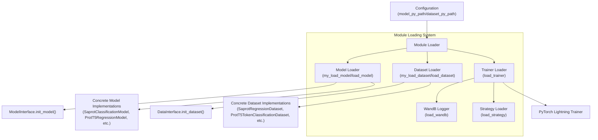
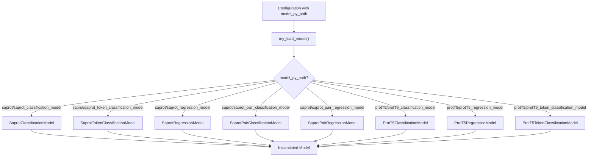
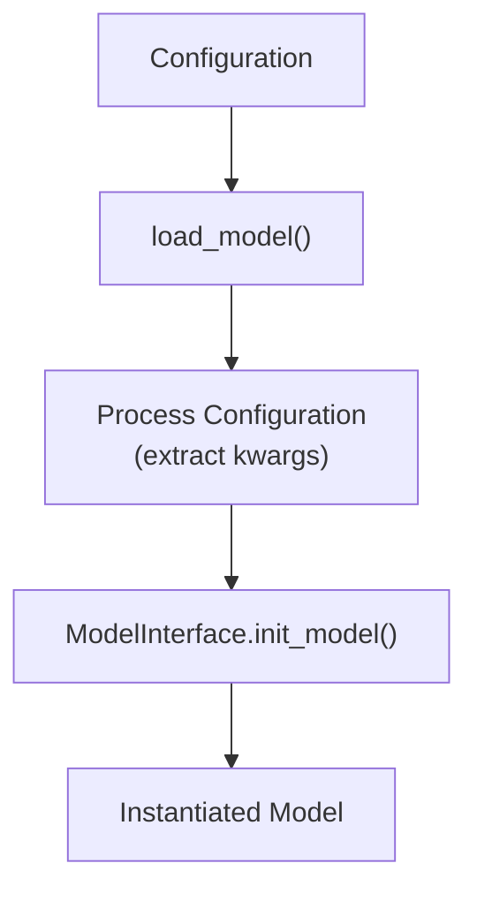
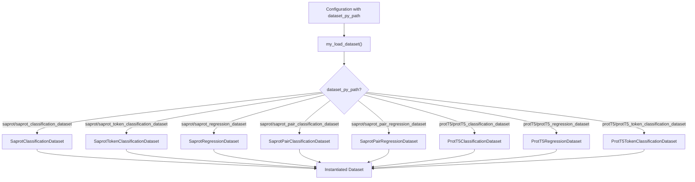
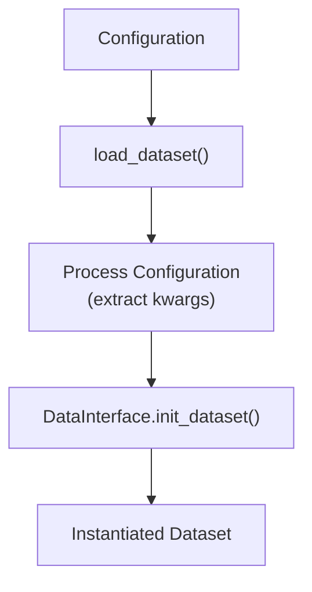
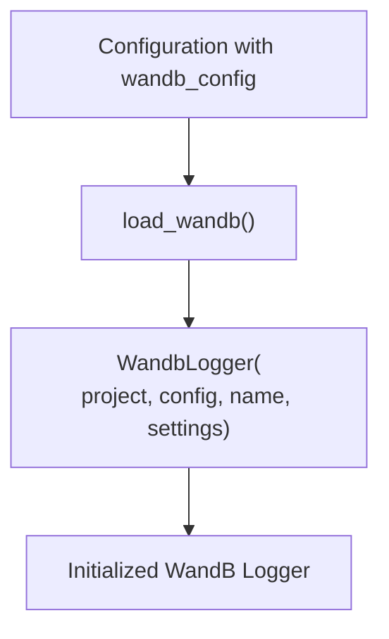
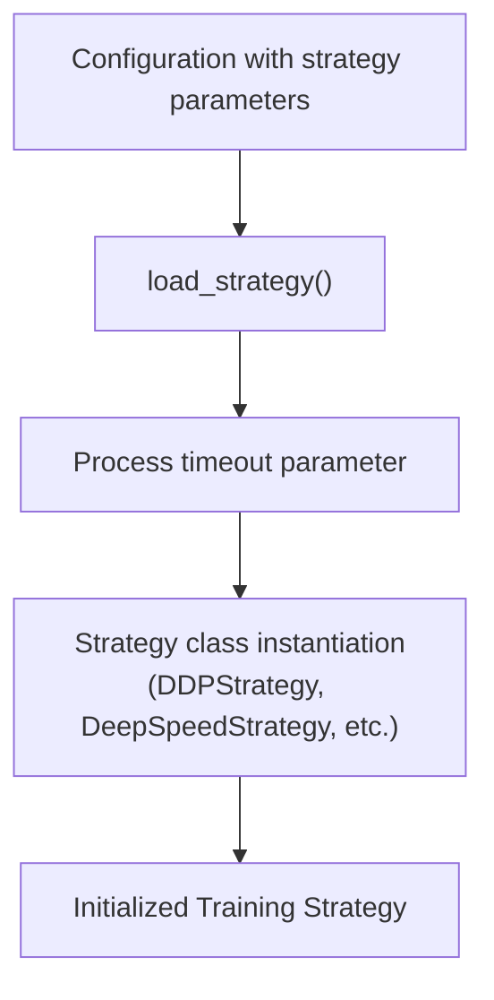
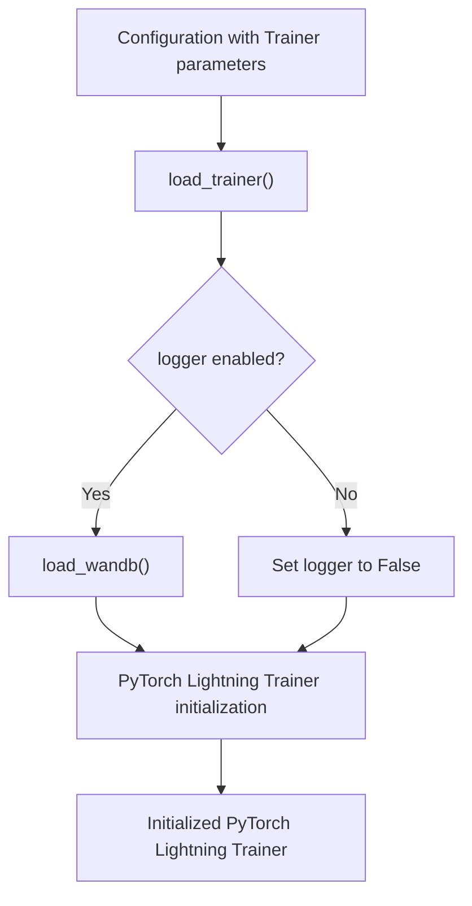
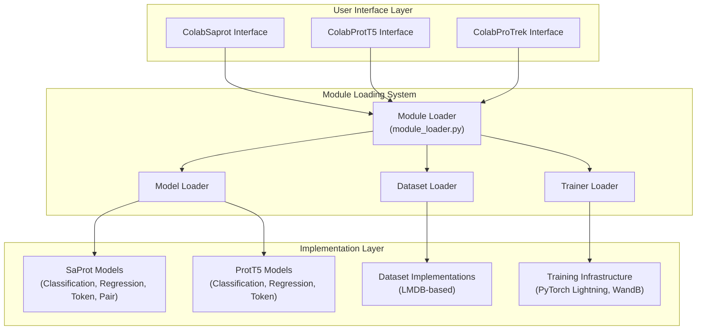

# Module Loading System

Relevant source files

The following files were used as context for generating this wiki page:

- [saprot/utils/module_loader.py](saprot/utils/module_loader.py)

## Purpose and Scope

The Module Loading System is a core component of SaprotHub that provides dynamic, configuration-based loading of models, datasets, and training infrastructure. It enables the framework to flexibly instantiate different components based on configuration parameters rather than hard-coded implementations. This document explains how the module loading system works, its architecture, and its role in enabling the dynamic behavior of SaprotHub.

The module loading system primarily handles:
- Dynamic model instantiation
- Dataset loading
- Training configuration (including WandB logging and PyTorch Lightning trainer setup)

For information about model architecture specifics, see [Model Architecture](#3).
For information about data processing, see [Data Processing](#4).

## System Architecture Overview

The Module Loading System serves as a bridge between configuration parameters and concrete implementations of models and datasets. It translates high-level specifications into instantiated objects ready for training or inference.

Sources: [saprot/utils/module_loader.py:13-187]()

## Model Loading Subsystem

The model loading subsystem is responsible for dynamically instantiating the appropriate model class based on configuration parameters. It supports both direct loading (`my_load_model`) and interface-based loading (`load_model`).

### Direct Model Loading

The `my_load_model` function directly imports and instantiates specific model classes based on the `model_py_path` parameter:

Sources: [saprot/utils/module_loader.py:15-58]()

### Interface-based Model Loading

The `load_model` function uses the `ModelInterface.init_model` method, which provides a more abstracted way to instantiate models:

Sources: [saprot/utils/module_loader.py:113-123]()

## Dataset Loading Subsystem

Similar to model loading, the dataset loading subsystem dynamically instantiates dataset classes based on configuration parameters.

### Direct Dataset Loading

The `my_load_dataset` function directly imports and instantiates specific dataset classes based on the `dataset_py_path` parameter:

Sources: [saprot/utils/module_loader.py:64-101]()

### Interface-based Dataset Loading

The `load_dataset` function uses the `DataInterface.init_dataset` method for more abstracted dataset instantiation:

Sources: [saprot/utils/module_loader.py:126-136]()

## Trainer and Logger Integration

The module loading system also handles setting up PyTorch Lightning trainers and WandB loggers, which are essential for model training.

### WandB Logger Loading

The `load_wandb` function initializes a WandB logger based on configuration:

Sources: [saprot/utils/module_loader.py:103-110]()

### Training Strategy Loading

The `load_strategy` function configures PyTorch Lightning training strategies (though currently disabled in Colab environments):

Sources: [saprot/utils/module_loader.py:162-169]()

### Trainer Loading

The `load_trainer` function configures and initializes a PyTorch Lightning trainer:

Sources: [saprot/utils/module_loader.py:173-187]()

## Configuration-Based Loading System

The module loading system in SaprotHub follows a configuration-based approach, where components are instantiated based on configuration dictionaries rather than direct code references. This enables several key benefits:

### Configuration Structure and Parameters

| Configuration Key | Purpose | Example Value |
|------------------|---------|---------------|
| `model_py_path`  | Identifies the model type to load | `"saprot/saprot_classification_model"` |
| `dataset_py_path` | Identifies the dataset type to load | `"saprot/saprot_regression_dataset"` |
| `kwargs` | Additional parameters for model/dataset | `{"num_labels": 3, "task": "classification"}` |
| `Trainer` | PyTorch Lightning trainer parameters | `{"logger": true, "max_epochs": 10}` |
| `setting.wandb_config` | WandB logger configuration | `{"project": "protein_classification", "name": "experiment1"}` |

### Benefits of Dynamic Loading

1. **Flexibility**: Allows switching between different model and dataset types without changing core code
2. **Extensibility**: New model and dataset types can be added by extending the conditional logic
3. **Configuration-driven**: System behavior can be changed through configuration files rather than code changes
4. **Separation of concerns**: The loading system is decoupled from the actual model and dataset implementations

## Integration with the Broader SaprotHub System

The Module Loading System plays a critical role in the SaprotHub architecture by connecting the user interface components with the underlying model and dataset implementations:

Sources: [saprot/utils/module_loader.py:1-187]()

## Usage Example

When a user wants to train a new model through the SaprotHub interface, the module loading system enables this workflow:

1. User selects model type and parameters in the interface
2. Interface constructs a configuration dictionary
3. Module loading system uses that configuration to:
   - Load the appropriate model class
   - Load the appropriate dataset
   - Configure the training environment (trainer, logger)
4. Training begins with all components properly instantiated

This approach allows users to focus on the high-level task rather than implementation details, while still providing flexibility for advanced users who want to customize the components.

---