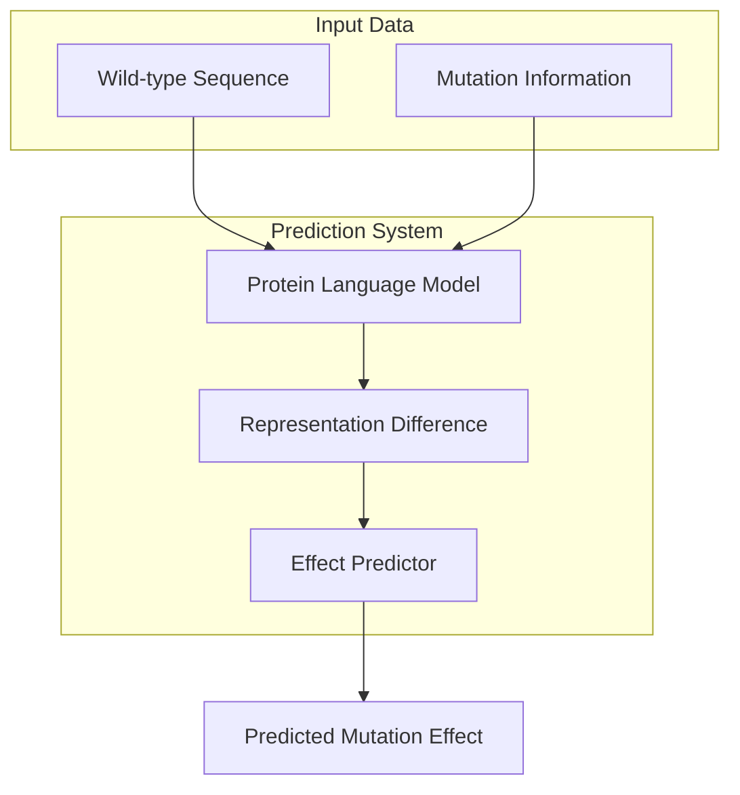
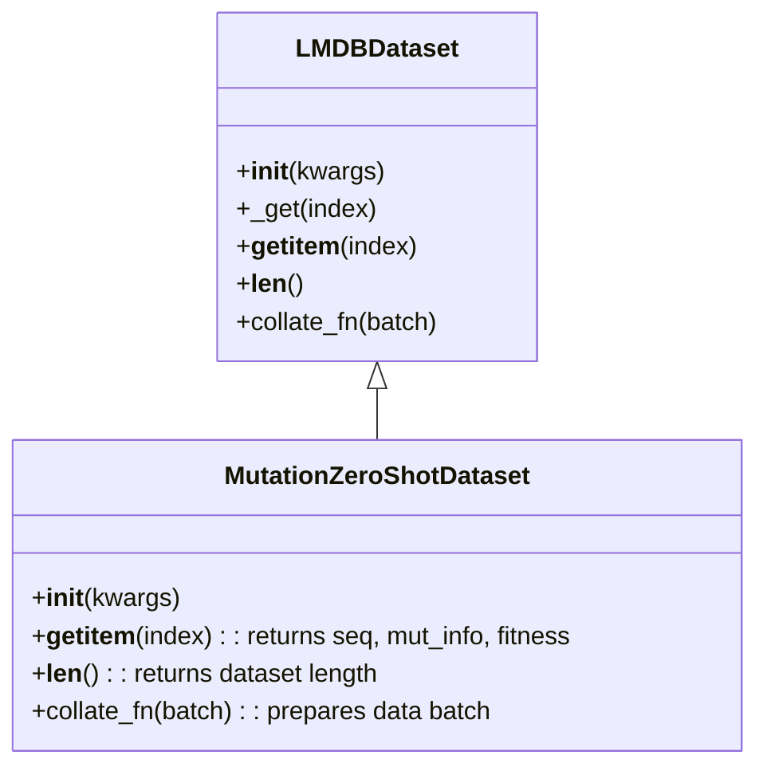
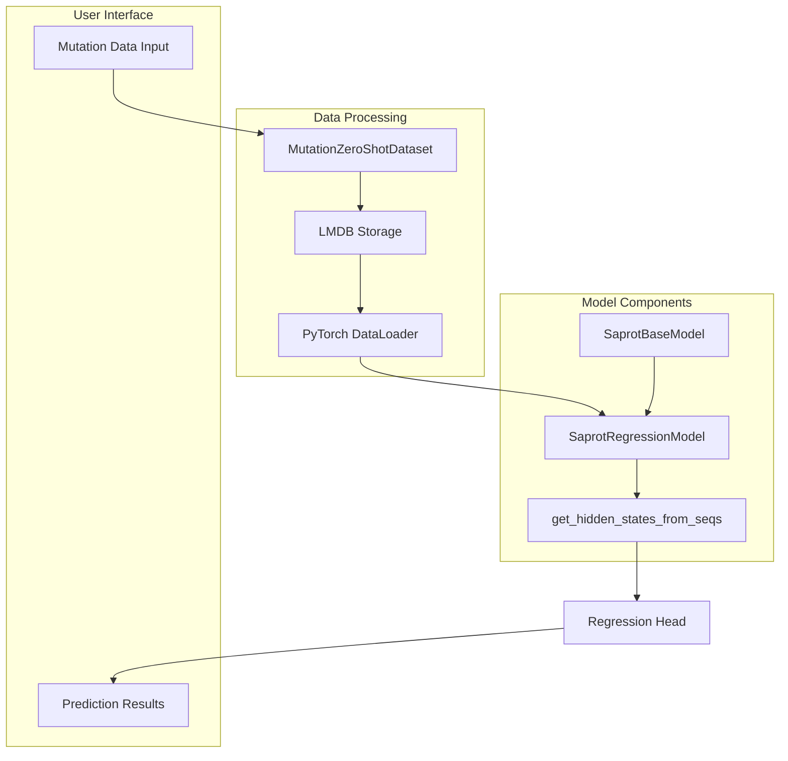
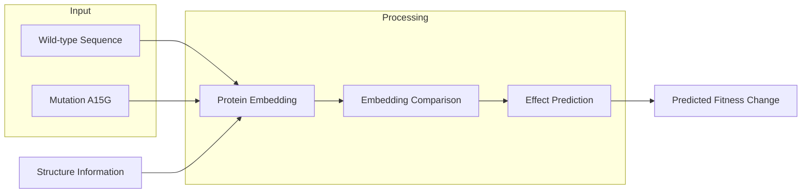
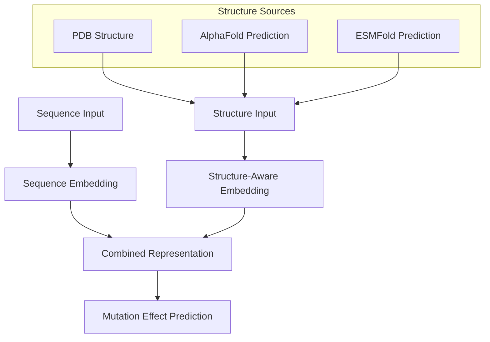
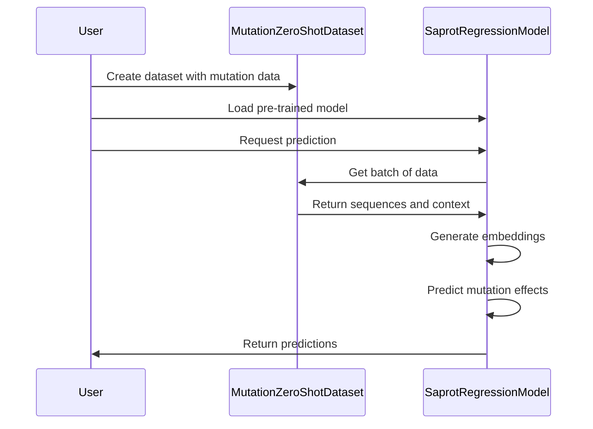

# Zero-Shot Mutation Prediction

<details>
<summary>Relevant source files</summary>

The following files were used as context for generating this wiki page:

- [Figure/mutational_effect_prediction/dataset/pdb.png](Figure/mutational_effect_prediction/dataset/pdb.png)
- [Figure/mutational_effect_prediction/dataset/sa.png](Figure/mutational_effect_prediction/dataset/sa.png)
- [Figure/mutational_effect_prediction/dataset/uniprot_id.png](Figure/mutational_effect_prediction/dataset/uniprot_id.png)
- [saprot/dataset/mutation_zeroshot_dataset.py](saprot/dataset/mutation_zeroshot_dataset.py)

</details>


Zero-Shot Mutation Prediction is a powerful feature in SaprotHub that enables users to predict the effects of protein mutations without requiring training data for those specific mutations. This capability leverages the general understanding of protein sequence-structure-function relationships that pre-trained protein language models have acquired during their training.

For information about more general protein mutation prediction tasks that require training on mutation datasets, see [Model Types and Prediction Tasks](#3.3).

## Overview

Zero-shot mutation prediction allows researchers to estimate how mutations will affect protein properties such as stability, function, or fitness, even for mutations that were not present in any training dataset. This is particularly valuable for protein engineering applications where experimental data for novel mutations might be limited or unavailable.



Sources:
- saprot/dataset/mutation_zeroshot_dataset.py

## Dataset Structure for Mutation Prediction

SaprotHub implements a specialized dataset class called `MutationZeroShotDataset` to handle mutation data for zero-shot prediction tasks. This dataset inherits from the core `LMDBDataset` class and provides specific methods for working with mutation data.



Each item in the dataset contains:
- The protein sequence (`seq`)
- Mutation information (`mut_info`) detailing the amino acid changes
- Fitness or functional scores (`fitness`) associated with the mutations

The dataset also maintains reference information such as:
- The wild-type sequence
- Structure content and type when available
- pLDDT (predicted local distance difference test) scores for structural confidence

Sources:
- saprot/dataset/mutation_zeroshot_dataset.py

## Technical Implementation

The `MutationZeroShotDataset` class is implemented as follows:

1. **Initialization**: Inherits from `LMDBDataset` and uses its infrastructure for storing and retrieving data
2. **Item Retrieval**: The `__getitem__` method returns a tuple of (`seq`, `mut_info`, `fitness`) for each item
3. **Batch Preparation**: The `collate_fn` method prepares batches for model processing, aggregating key information:
   - Wild-type sequence
   - Mutant sequences
   - Mutation information
   - Structure data (when available)
   - pLDDT scores (when available)

This data organization enables the model to compare wild-type and mutant sequences effectively for prediction.

```python
# Key functionality from MutationZeroShotDataset
def __getitem__(self, index):
    data = json.loads(self._get(index))
    return data["seq"], data["mut_info"], data["fitness"]

def collate_fn(self, batch):
    seqs, mut_info, fitness = zip(*batch)
    
    # Get structural data if available
    plddt = self._get("plddt")
    if plddt is not None:
        plddt = json.loads(plddt)
    
    # Create inputs dictionary with all context
    inputs = {"wild_type": self._get("wild_type"),
              "seqs": seqs,
              "mut_info": mut_info,
              "structure_content": self._get("structure_content"),
              "structure_type": self._get("structure_type"),
              "plddt": plddt}

    # Convert fitness values to tensor
    labels = {"labels": torch.Tensor(fitness)}

    return inputs, labels
```

Sources:
- saprot/dataset/mutation_zeroshot_dataset.py

## Data Flow for Mutation Prediction

The following diagram illustrates how data flows through the SaprotHub system for zero-shot mutation prediction:



Sources:
- saprot/dataset/mutation_zeroshot_dataset.py

## Prediction Mechanism

The zero-shot mutation prediction works through the following process:

1. **Embedding Generation**: The model generates embeddings for both wild-type and mutant sequences
2. **Representation Comparison**: The system analyzes differences between these embeddings
3. **Effect Prediction**: Based on the embedding differences, the model predicts the mutation's effect on protein properties

When structural information is available, it can significantly enhance prediction accuracy by providing context about the 3D environment of the mutation site.



## Integrating Structure Information

SaprotHub can enhance mutation prediction by incorporating structural information when available:



Sources:
- saprot/dataset/mutation_zeroshot_dataset.py

## How to Use Zero-Shot Mutation Prediction

To use the zero-shot mutation prediction capability in SaprotHub:

1. **Prepare your mutation data**: Format your data with the wild-type sequence and the desired mutations.
2. **Create a dataset**: Use the `MutationZeroShotDataset` class to load your mutation data.
3. **Run prediction**: Use a pre-trained protein language model to predict the effects of the mutations.

### Example Usage Flow



## Applications

Zero-shot mutation prediction is particularly valuable for:

| Application | Description |
|-------------|-------------|
| Protein Engineering | Rapidly screening potential mutations for desired properties without experimental testing |
| Variant Effect Prediction | Assessing the impact of genetic variants on protein function |
| Antibody Design | Optimizing antibody sequences for improved binding or specificity |
| Enzyme Optimization | Identifying mutations that might enhance enzyme activity or stability |
| Drug Resistance | Predicting mutations that might confer resistance to drugs or treatments |

## Limitations and Considerations

While zero-shot mutation prediction is powerful, users should be aware of its limitations:

- Predictions are based on patterns learned from pre-training data and may not capture all protein-specific nuances
- Accuracy varies depending on protein family representation in the pre-training data
- Structural context significantly affects prediction accuracy, especially for mutations in functional sites
- Complex epistatic interactions between multiple mutations may not be fully captured
- Performance may vary depending on the distance between the query protein and proteins in the training data

## References and Related Pages

- For more information on the general model architecture, see [Model Architecture](#3)
- For details on dataset handling, see [Datasets and Data Formats](#4.1)
- For LMDB dataset construction, see [LMDB Dataset Construction](#4.2)
- For protein structure handling, see [Protein Structure Handling](#4.3)

Sources:
- saprot/dataset/mutation_zeroshot_dataset.py

---