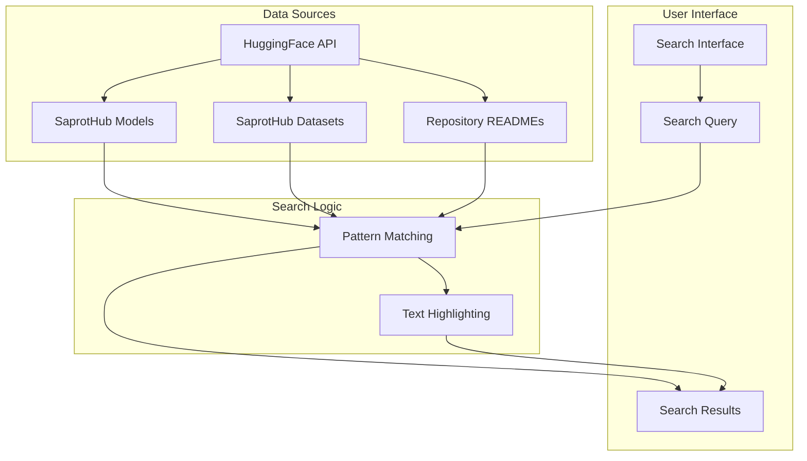
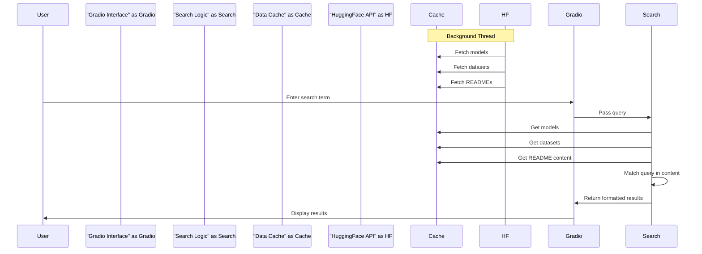
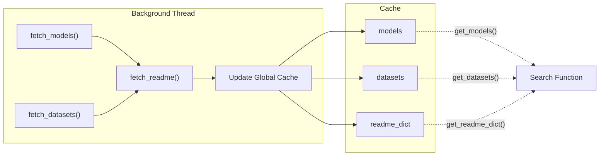
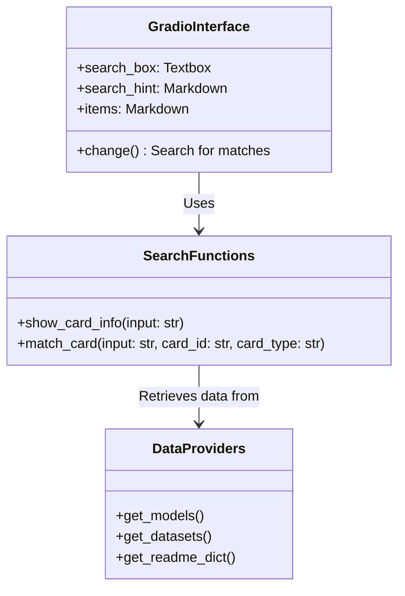
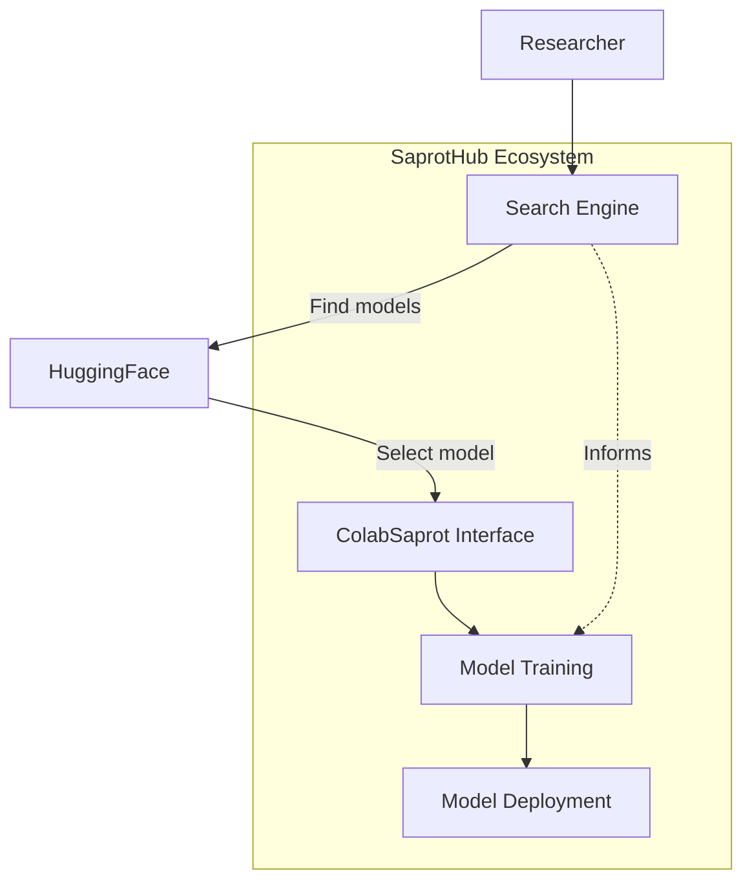

# Search Engine Integration

<details>
<summary>Relevant source files</summary>

The following files were used as context for generating this wiki page:

- [search_engine/app.py](search_engine/app.py)
- [search_engine/loop_retrieve_cards.py](search_engine/loop_retrieve_cards.py)
- [search_engine/utils.py](search_engine/utils.py)

</details>


The Search Engine Integration in SaprotHub provides a powerful interface for discovering and exploring available protein language models and datasets. This system allows researchers to efficiently search through models and datasets hosted on the HuggingFace Hub by the SaprotHub team, making it easier to find appropriate resources for specific protein analysis tasks.

## 1. Overview

The search engine offers a simple yet effective way to search across model and dataset repositories using keywords. It retrieves information from HuggingFace, highlighting matches in both repository names and their README documentation, providing an organized view of available resources.



Sources: [search_engine/app.py:1-84](), [search_engine/utils.py:1-89](), [search_engine/loop_retrieve_cards.py:1-57]()

## 2. Architecture Components

The search engine consists of three main components:

1. **User Interface** - A Gradio-based web interface for submitting search queries
2. **Data Retrieval** - Background processes that fetch model and dataset information
3. **Search Logic** - Functions that match query terms and format results

### 2.1 Component Interaction



Sources: [search_engine/app.py:67-83](), [search_engine/loop_retrieve_cards.py:29-56]()

## 3. Implementation Details

### 3.1 Data Retrieval System

The search engine uses a background thread to continuously update its cache of models, datasets, and README files from HuggingFace. This ensures that the search results always reflect the most recent repositories without requiring manual updates.



Sources: [search_engine/loop_retrieve_cards.py:1-57](), [search_engine/utils.py:5-63]()

### 3.2 Search Functionality

The search algorithm works by:

1. Taking a user input query string
2. Searching for this string in model/dataset names and README contents
3. Highlighting matches using HTML span elements
4. Organizing results by type (models and datasets)
5. Providing direct links to the HuggingFace repositories

The search is case-insensitive and filters out matches that only appear in HTML comments.

Table: Core Search Functions

| Function | Purpose | File Location |
|----------|---------|---------------|
| `match_card()` | Searches for query in a specific card and formats the result | [search_engine/app.py:13-48]() |
| `show_card_info()` | Processes all models and datasets for matches | [search_engine/app.py:51-65]() |
| `set_text_bg_color()` | Highlights matched text in search results | [search_engine/utils.py:65-88]() |

Sources: [search_engine/app.py:13-65](), [search_engine/utils.py:65-88]()

### 3.3 User Interface

The search interface is built using Gradio, a Python library for creating customizable web interfaces. The UI consists of:

1. A simple text input box for entering search terms
2. A results area that updates automatically as you type
3. Sections for models and datasets, each with highlighted matches



Sources: [search_engine/app.py:68-83]()

## 4. API Interactions with HuggingFace

The search engine interacts with the HuggingFace API to retrieve model and dataset information. The system uses HuggingFace Mirror (`hf-mirror.com`) as the API endpoint, which may provide better performance depending on geographic location.

### 4.1 HuggingFace API Requests

Table: HuggingFace API Endpoints Used

| Function | Endpoint | Purpose |
|----------|----------|---------|
| `fetch_models()` | `https://hf-mirror.com/api/models?author=SaProtHub` | Retrieves all models by SaprotHub |
| `fetch_datasets()` | `https://hf-mirror.com/api/datasets?author=SaProtHub` | Retrieves all datasets by SaprotHub |
| `fetch_readme()` (models) | `https://hf-mirror.com/{card_id}/raw/main/README.md` | Gets README for a specific model |
| `fetch_readme()` (datasets) | `https://hf-mirror.com/datasets/{card_id}/raw/main/README.md` | Gets README for a specific dataset |

Sources: [search_engine/utils.py:5-63]()

## 5. Usage

### 5.1 Accessing the Search Engine

The search engine can be started by running the app.py file, which launches a Gradio server:

```bash
python search_engine/app.py
```

This starts a web server on `0.0.0.0` which makes the search interface accessible from a web browser.

### 5.2 Performing Searches

1. Enter a keyword in the search box
2. Results will automatically update as you type
3. Matches are highlighted in yellow
4. Click on model/dataset names to visit their HuggingFace repositories

### 5.3 Search Result Structure

Search results are organized into two main sections:

1. **Models** - Matching protein language models (e.g., SaProt-based models for specific tasks)
2. **Datasets** - Matching protein datasets used for training or evaluation

Each result includes:
- Repository name with link to HuggingFace
- Highlighted snippets from README that match your search term

Sources: [search_engine/app.py:51-65]()

## 6. Integration with SaprotHub

The search engine serves as a discovery tool within the broader SaprotHub ecosystem, helping researchers find appropriate pre-trained models and datasets for their specific protein analysis tasks. It complements the model training and fine-tuning capabilities of SaprotHub by making it easy to find existing resources before deciding to train new models.



The search engine integration helps researchers efficiently navigate the growing collection of protein language models and datasets within the SaprotHub project, enabling them to build upon existing work and focus their research efforts.

Sources: [search_engine/app.py:1-84](), [search_engine/utils.py:1-89](), [search_engine/loop_retrieve_cards.py:1-57]()