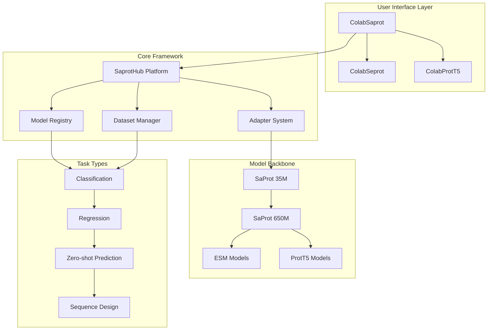

SaprotHub is a revolutionary platform that democratizes protein language model training, sharing, and collaboration for the entire biology community. Built around the concept of making advanced protein modeling accessible to all biologists—regardless of their coding or machine learning background—SaprotHub provides an intuitive interface for training custom protein models without requiring extensive technical expertise.

## What Makes SaprotHub Unique

### Core Innovation: Structure-Aware Protein Modeling
SaprotHub introduces **Structure-Aware (SA) sequences**, a breakthrough approach that combines amino acid residues with structural information at each position. Unlike traditional protein language models that only consider sequence data, SA sequences integrate 3D structural information encoded through Foldseek, enabling more accurate and contextually rich protein representations.

### The Adapter Mechanism
At the heart of SaprotHub's collaborative approach is the **Adapter mechanism**, which allows researchers to train lightweight task-specific adapters while sharing a common backbone model. This approach dramatically reduces storage and communication costs, enabling efficient model sharing and collaborative development—much like grafting different fruits onto a single tree trunk.

## Architecture Overview

## Supported Task Categories

SaprotHub supports a comprehensive range of protein prediction tasks, organized into six main categories:

| Task Category | Description | Example Applications |
|---------------|-------------|---------------------|
| **Protein-Level Classification** | Classify entire protein sequences | Fold class prediction, localization prediction, function prediction |
| **Protein-Level Regression** | Predict numerical properties of proteins | Thermal stability, fluorescence intensity, binding affinity |
| **Protein-Protein Classification** | Predict interactions between protein pairs | PPI prediction, interaction type classification |
| **Protein-Protein Regression** | Quantify interaction strengths | Binding free energy, interaction affinity |
| **Zero-shot Mutation Effect** | Predict effects without training | Enzyme activity, virus fitness, driver mutations |
| **Protein Sequence Design** | Generate novel protein sequences | Enzyme optimization, stability enhancement, antibody design |

## Getting Started Paths

SaprotHub offers multiple entry points depending on your needs:

### 🚀 Quick Start with Colab
- **[ColabSaprot](https://colab.research.google.com/github/westlake-repl/SaprotHub/blob/main/colab/SaprotHub_v2.ipynb)**: Access SaProt models (35M, 650M parameters)
- **[ColabSeprot](https://colab.research.google.com/github/westlake-repl/SaprotHub/blob/main/colab/ColabSeprot.ipynb)**: Access multiple models including ESM1b, ESM2, ProtBert, ProTrek
- **[ColabProtT5](https://colab.research.google.com/github/westlake-repl/SaprotHub/blob/main/colab/ColabProtT5.ipynb)**: Access ProtT5-based models

### 🏠 Local Deployment
For users preferring local environments, SaprotHub provides comprehensive [local server deployment](https://github.com/westlake-repl/SaprotHub/blob/main/local_server) options for both Linux and Windows systems.

## The OPMC Vision

SaprotHub is the pioneering implementation of the **Open Protein Modeling Consortium (OPMC)**, a collaborative initiative aimed at:
- Fostering resource sharing and co-development
- Enabling decentralized model training
- Building a community-driven protein modeling ecosystem

The OPMC brings together multiple protein language model platforms under a unified framework, allowing researchers to contribute, share, and build upon each other's work.

## Model Ecosystem

SaprotHub supports six types of models, each serving different purposes:

| Model Type | Use Case | Description |
|------------|----------|-------------|
| **Official Pretrained SaProt (35M)** | Training | Lightweight model for rapid prototyping |
| **Official Pretrained SaProt (650M)** | Training | Full-featured model for maximum performance |
| **Self-Trained Models** | Continual training, prediction | Models you train on ColabSaprot |
| **Community Shared Models** | Continual training, prediction | Models shared on SaprotHub platform |
| **Local Models** | Continual training, prediction | Models saved locally as .zip files |
| **Multi-Model Ensembles** | Prediction | Combines multiple models for improved accuracy |

## Data Format Flexibility

SaprotHub accommodates multiple data input formats:

### Single Protein Inputs
- AA sequences
- SA sequences (structure-aware)
- UniProt IDs
- PDB/CIF structure files

### Multiple Protein Inputs
- Batch AA sequences
- Batch SA sequences
- Batch UniProt IDs
- Batch structure files

### Pair-based Inputs
For protein-protein interaction tasks:
- Pairs of AA sequences
- Pairs of SA sequences
- Pairs of UniProt IDs
- Pairs of structure files

## Community and Support

SaprotHub maintains active community engagement through:
- **Slack Group**: [Join discussions](https://westlakeai.slack.com/archives/C08JNBN40P7)
- **WeChat Groups**: Two active groups with 500+ researchers
- **Hugging Face Hub**: [Model and dataset repository](https://huggingface.co/SaProtHub)
- **Documentation and Tutorials**: Comprehensive guides and video tutorials

## Next Steps

To get started with SaprotHub:

1. **[Quick Start](2-quick-start)**: Set up your first protein model
2. **[Understanding Protein Prediction Tasks](3-understanding-protein-prediction-tasks)**: Learn about different task types
3. **[Preparing Your Dataset](4-preparing-your-dataset)**: Format your data for SaprotHub
4. **[Choosing the Right Model](5-choosing-the-right-model)**: Select the appropriate model for your needs

> [!TIP]
> Start with ColabSaprot for the most user-friendly experience. It provides guided interfaces for training and prediction without requiring any local setup or coding knowledge.

> [!TIP]
> For protein structure-related tasks, always use SA sequences instead of plain AA sequences. The structural information significantly improves prediction accuracy for most biological applications.