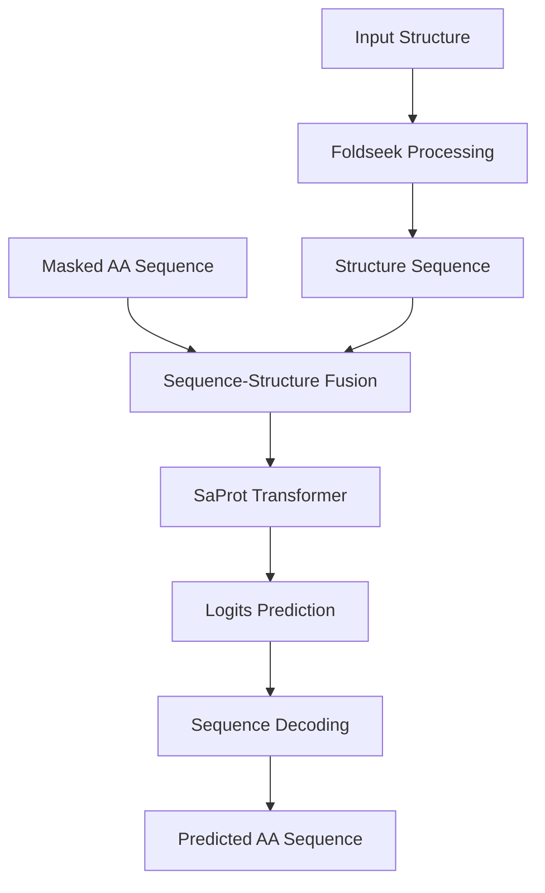

Protein inverse folding is the computational challenge of predicting amino acid sequences that fold into specific three-dimensional structures. This capability is crucial for protein engineering, drug design, and understanding the sequence-structure relationship in proteins. SaProt provides a specialized inverse folding model that leverages structure-aware representations to generate sequences compatible with target protein structures.

## Model Architecture

The SaProt Inverse Folding Model (`SaProtIFModel`) extends the base SaProt architecture specifically for sequence generation tasks. It operates as a language model with masked token reconstruction capabilities, trained to predict amino acids given structural context [saprot/model/saprot/saprot_if_model.py#L11-L17].



The model inherits from `SaprotBaseModel` with task configuration set to 'lm' (language modeling) [saprot/model/saprot/saprot_if_model.py#L16-L17]. This enables the model to handle sequence generation tasks while maintaining structure awareness through the underlying transformer architecture.

## Core Prediction Mechanism

### Input Processing

The inverse folding process begins with two essential inputs:
- **Amino acid sequence**: Can be fully or partially masked (using `#` as mask token)
- **Structure sequence**: Foldseek-derived structural representation

The model fuses these inputs by interleaving amino acid and structural tokens [saprot/model/saprot/saprot_if_model.py#L99]:

```python
sa_seq = "".join(f"{aa}{struc}" for aa, struc in zip(aa_seq, struc_seq))
```

### Prediction Methods

The model supports two distinct prediction strategies [saprot/model/saprot/saprot_if_model.py#L77-L93]:

| Method | Description | Use Case | Sample Count |
|--------|-------------|----------|--------------|
| **argmax** | Selects most probable amino acid | Deterministic prediction | 1 |
| **multinomial** | Samples from probability distribution | Stochastic exploration | Multiple |

> [!TIP]
> The multinomial method is particularly useful for generating diverse sequence variants when exploring the sequence space around a target structure, while argmax provides the most likely sequence according to the model.

### Loss Function and Training

During training, the model employs cross-entropy loss with masked tokens [saprot/model/saprot/saprot_if_model.py#L29-L46]:

```python
loss = cross_entropy(logits, labels, ignore_index=-1)
```

The model tracks accuracy metrics for masked token prediction, enabling optimization of sequence reconstruction capabilities.

## Data Processing Pipeline

### Structure Sequence Generation

Structure sequences are generated using Foldseek, which converts 3D protein structures into discrete structural alphabets [saprot/utils/foldseek_util.py#L12-L18]. The `get_struc_seq` function processes PDB files and applies confidence masking based on pLDDT scores:

```python
def get_struc_seq(foldseek, path, chains: list = None, plddt_mask: bool = True, 
                  plddt_threshold: float = 70., foldseek_verbose: bool = False)
```

> [!TIP]
> The pLDDT masking feature allows the model to ignore low-confidence structural regions, improving prediction reliability by focusing on well-defined structural elements.

### Training Data Preparation

The `SaprotLMDataset` class handles data preparation for inverse folding training [saprot/dataset/saprot/saprot_lm_dataset.py#L15-L18]. Key features include:

- **BERT-style masking**: 15% of tokens are masked with 80% mask token, 10% random token, 10% unchanged [saprot/dataset/saprot/saprot_lm_dataset.py#L87-L110]
- **Structure integration**: Optional coordinate bias features for enhanced structural awareness
- **Flexible sequence length**: Configurable maximum sequence length (default 512)

## Model Initialization and Configuration

### Basic Setup

The inverse folding model is initialized through the model interface system [saprot/model/model_interface.py#L89-L100]:

```python
from saprot.model.model_interface import ModelInterface
model = ModelInterface.init_model("saprot/saprot_if_model.py", **kwargs)
```

### Configuration Parameters

The base model supports extensive configuration options [saprot/model/saprot/base.py#L26-L35]:

| Parameter | Type | Default | Description |
|-----------|------|---------|-------------|
| `task` | str | 'lm' | Task type (language modeling) |
| `config_path` | str | - | HuggingFace model config path |
| `load_pretrained` | bool | False | Load pretrained weights |
| `freeze_backbone` | bool | False | Freeze transformer backbone |
| `gradient_checkpointing` | bool | False | Enable memory optimization |
| `lora_kwargs` | dict | None | LoRA adaptation configuration |

## Usage Examples

### Basic Sequence Prediction

```python
# Initialize model
model = ModelInterface.init_model("saprot/saprot_if_model.py", 
                                 config_path="path/to/config")

# Predict sequence from structure
aa_seq = "####"  # Fully masked sequence
struc_seq = "aBcDeFgH"  # Foldseek structure sequence
predicted = model.predict(aa_seq, struc_seq, method="argmax")
```

### Stochastic Sequence Generation

```python
# Generate multiple sequence variants
variants = model.predict(
    aa_seq="A#C##G",  # Partially masked
    struc_seq="aBcDeFgH",
    method="multinomial",
    num_samples=5
)
```

## Integration with Training Pipeline

The inverse folding model integrates seamlessly with the training infrastructure:

- **Distributed training**: Supports multi-GPU training with proper metric aggregation [saprot/model/saprot/saprot_if_model.py#L55-L75]
- **Validation monitoring**: Tracks accuracy and loss for model selection
- **Checkpoint management**: Automatic model saving based on validation performance

## Next Steps

For comprehensive understanding of structure-aware processing, explore [Structure-Aware Protein Representation](6-structure-aware-protein-representation). To implement inverse folding in practice, refer to [Preparing Your Dataset](4-preparing-your-dataset) for data format requirements and [Choosing the Right Model](5-choosing-the-right-model) for model selection guidance.

For advanced ensemble approaches combining multiple predictions, see [Multi-model Ensemble Prediction](11-multi-model-ensemble-prediction).