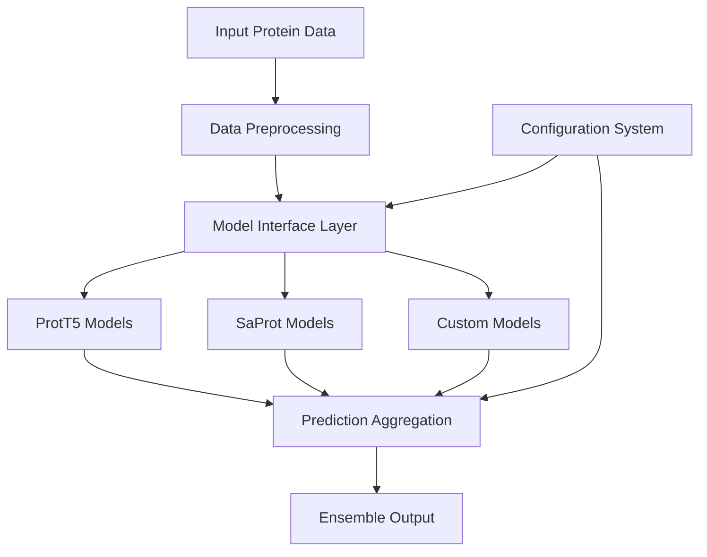
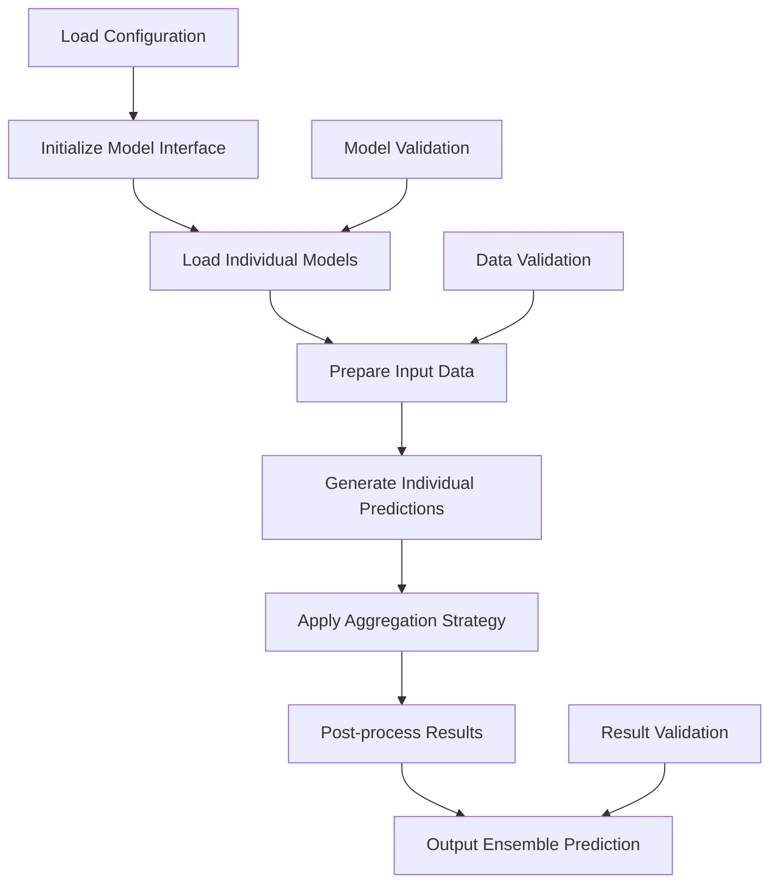

Multi-model ensemble prediction in SaprotHub enables developers to leverage multiple protein representation models simultaneously, combining their strengths to achieve superior prediction performance across diverse protein tasks. This approach integrates both sequence-based models like ProtT5 and structure-aware models like SaProt, allowing for robust predictions that capture complementary aspects of protein biology.

## Ensemble Architecture Overview

SaprotHub's ensemble prediction framework is built upon a modular architecture that supports seamless integration of multiple model types. The core components work together through a unified interface that standardizes model initialization, data processing, and prediction aggregation.



The ensemble system leverages the `ModelInterface` class [saprot/model/model_interface.py](saprot/model/model_interface.py#L89-L104) as the central orchestrator, which dynamically loads and initializes different model types based on configuration specifications. This design allows for flexible model combinations without requiring code modifications.

## Model Integration Framework

### Supported Model Types

The ensemble framework supports multiple model architectures, each optimized for different protein prediction tasks:

| Model Type | Architecture | Primary Use Cases | Key Features |
|------------|-------------|-------------------|--------------|
| ProtT5 Classification | Transformer-based encoder | Protein classification, functional annotation | Sequence-only processing, pre-trained on massive protein datasets |
| SaProt Classification | Structure-aware transformer | Structure-dependent tasks | Integrates 3D structure via Foldseek encoding |
| ProtT5 Regression | Transformer encoder | Continuous value prediction | Stability, binding affinity prediction |
| SaProt Regression | Structure-aware transformer | Structure-based regression | Combines sequence and structural features |

### Model Loading Mechanism

The ensemble system uses a sophisticated model loading strategy implemented in `module_loader.py` [saprot/utils/module_loader.py](saprot/utils/module_loader.py#L15-L73). The `my_load_model` function dynamically imports and instantiates models based on configuration parameters:

```python
def my_load_model(config):
    model_config = copy.deepcopy(config)
    model_type = model_config.pop("model_py_path")
    
    if model_type == "saprot/saprot_classification_model":
        from model.saprot.saprot_classification_model import SaprotClassificationModel
        return SaprotClassificationModel(**model_config)
    # Additional model types follow similar pattern
```

This approach enables runtime model selection and configuration without hardcoding dependencies.

## Configuration-Driven Ensemble Setup

### Ensemble Configuration Structure

Ensemble prediction is configured through YAML files that specify model combinations and their respective parameters. The configuration system supports both individual model settings and ensemble-level parameters.

> [!TIP]
> The configuration system uses hierarchical inheritance where ensemble-level settings can override individual model defaults, enabling fine-grained control over prediction behavior.

### Example Ensemble Configuration

```yaml
ensemble:
  models:
    - model_py_path: saprot/saprot_classification_model
      weight: 0.6
      kwargs:
        config_path: westlake-repl/SaProt_35M_AF2
        load_pretrained: True
    - model_py_path: protT5/protT5_classification_model
      weight: 0.4
      kwargs:
        config_path: Rostlab/prot_t5_xl_uniref50
        load_pretrained: True
  
  aggregation_strategy: weighted_average
  output_format: probabilities
```

## Prediction Aggregation Strategies

### Weighted Averaging

The most common ensemble approach combines model outputs through weighted averaging, where each model's contribution is scaled by its confidence or historical performance. This method is particularly effective for classification tasks where probability distributions need to be combined.

### Voting Mechanisms

For discrete predictions, the ensemble supports both hard voting (majority rule) and soft voting (probability-weighted) strategies. The choice depends on the task requirements and the diversity of model outputs.

### Custom Aggregation Functions

Advanced users can implement custom aggregation functions that incorporate domain-specific knowledge or task-specific logic. The framework provides extension points for integrating these custom strategies.

## Implementation Workflow

### Step-by-Step Ensemble Prediction



### Zero-shot Mutation Prediction Example

The ensemble framework is particularly powerful for zero-shot mutation effect prediction, as demonstrated in the mutation zeroshot script [saprot/scripts/mutation_zeroshot.py](saprot/scripts/mutation_zeroshot.py#L17-L56):

```python
def run(config):
    # Initialize ensemble models
    models = [load_model(model_config) for model_config in config.ensemble.models]
    
    # Initialize dataset
    data_module = load_dataset(config.dataset)
    
    # Generate ensemble predictions
    for name in tqdm(os.listdir(config.setting.dataset_dir)):
        individual_predictions = []
        for model in models:
            result = trainer.test(model=model, datamodule=data_module)
            individual_predictions.append(result[0]['spearman'])
        
        # Aggregate predictions
        ensemble_result = aggregate_predictions(individual_predictions, config.ensemble.aggregation_strategy)
```

## Performance Optimization

### Parallel Processing

The ensemble system supports parallel model execution to maximize computational efficiency. Models can be distributed across multiple GPUs or nodes, with results collected and aggregated centrally.

### Memory Management

To handle large-scale ensemble predictions, the framework implements intelligent memory management strategies, including model caching and batch processing optimizations.

### Caching Strategies

Prediction results can be cached at multiple levels to avoid redundant computations, particularly useful when evaluating the same protein across multiple ensemble configurations.

## Advanced Features

### Dynamic Model Selection

The ensemble framework can dynamically select the most appropriate model subset based on input characteristics, task requirements, or computational constraints.

### Confidence Estimation

Beyond point predictions, the ensemble provides confidence estimates by analyzing the consensus among individual models, helping users assess prediction reliability.

### Ensemble Diagnostics

Comprehensive diagnostic tools help analyze ensemble performance, identify model disagreements, and optimize model weights for specific tasks.

## Integration with Existing Workflows

### Seamless API Integration

The ensemble prediction system integrates seamlessly with existing SaprotHub workflows through the standardized `ModelInterface` [saprot/model/model_interface.py](saprot/model/model_interface.py#L89-L104), requiring minimal changes to existing pipelines.

### Backward Compatibility

Legacy single-model configurations remain fully supported, allowing gradual migration to ensemble approaches without disrupting existing workflows.

### Extensibility

The modular design enables easy addition of new model types and aggregation strategies, ensuring the framework can evolve with advancing protein representation techniques.

## Best Practices

### Model Selection Guidelines

Choose complementary models that capture different aspects of protein biology. For optimal performance, combine sequence-based models with structure-aware models when structural information is available.

### Weight Tuning

Optimize model weights based on validation performance for specific tasks. Consider cross-validation to ensure robust weight selection.

### Validation Strategies

Implement rigorous validation procedures to assess ensemble performance, including comparison against individual models and baseline methods.

Multi-model ensemble prediction represents a powerful approach for leveraging the complementary strengths of diverse protein representation models, enabling more accurate and robust predictions across the full spectrum of protein science applications.

For next steps, explore [Structure-Aware Sequence Generation](12-structure-aware-sequence-generation) to understand how ensemble predictions can inform protein design tasks, or review [Dataset Format Requirements](13-dataset-format-requirements) to ensure your data is properly formatted for ensemble analysis.