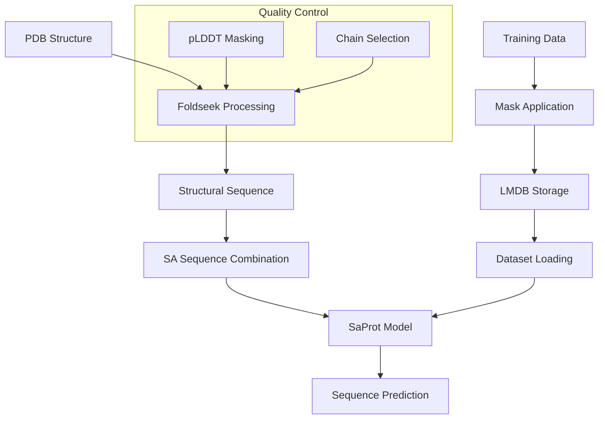
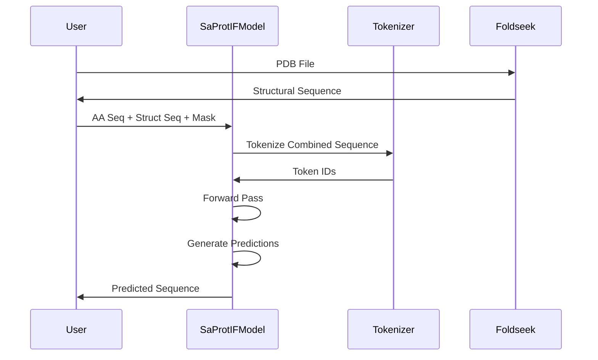

Structure-aware sequence generation in SaprotHub represents a sophisticated approach to protein design that integrates both sequence and structural information through the powerful **SaProt inverse folding model**. This capability enables the prediction of amino acid sequences that are compatible with given protein structures, opening doors to novel protein engineering and design applications.

## Core Architecture and Data Flow

The structure-aware sequence generation pipeline operates through a coordinated system of data processing, model architecture, and prediction mechanisms. The process begins with structural representation conversion using **Foldseek**, which transforms 3D protein coordinates into discrete structural sequences that can be processed by the transformer model.

The **SaprotSequenceDesignDataset** class handles the training data preparation by implementing a comprehensive masking strategy where amino acids are systematically replaced with mask tokens (`#`) to create reconstruction tasks [source](saprot/dataset/saprot/saprot_seq_design_dataset.py#L52-L61). This approach trains the model to understand the relationship between structure and sequence through self-supervised learning.

## Structural Sequence Generation Process

### Foldseek Integration

The foundation of structure-aware generation lies in the **Foldseek utility** that converts 3D protein structures into 1D structural sequences [source](saprot/utils/foldseek_util.py#L12-L90). This process involves:

1. **Structure-to-Descriptor Conversion**: Using Foldseek's `structureto3didescriptor` command to extract structural representations
2. **Quality Filtering**: Implementing pLDDT masking for AlphaFold2 predictions to ensure high-confidence structural regions
3. **Chain-wise Processing**: Handling multi-chain proteins with selective chain extraction

The structural sequences are then combined with amino acid sequences to create **SA sequences** where each amino acid is paired with its corresponding structural character.

> [!TIP]
> The pLDDT masking mechanism is crucial for quality control - regions with confidence scores below 70.0 are automatically masked, preventing the model from learning from unreliable structural predictions.

### Data Processing Pipeline

The training pipeline utilizes **LMDB datasets** for efficient storage and retrieval of protein data. The masking strategy employed in `SaprotSequenceDesignDataset._apply_mask()` systematically replaces amino acid tokens with mask tokens while preserving the original tokens as labels for the reconstruction task [source](saprot/dataset/saprot/saprot_seq_design_dataset.py#L52-L61).

| Processing Stage | Input | Output | Purpose |
|---|---|---|---|
| Tokenization | Raw sequence | Token IDs | Convert to model-readable format |
| Masking | Token sequence | Masked tokens + labels | Create reconstruction targets |
| Collation | Batch of samples | Model inputs | Prepare for batch processing |

## Model Architecture and Prediction

### SaProt Inverse Folding Model

The **SaProtIFModel** extends the base Saprot architecture specifically for sequence generation tasks [source](saprot/model/saprot/saprot_if_model.py#L11-L131). The model operates through:

1. **Structure Integration**: Adding bias features from coordinate information when available
2. **Transformer Processing**: Standard transformer forward pass with combined sequence-structure inputs
3. **Loss Calculation**: Cross-entropy loss with accuracy metrics for reconstruction evaluation

### Prediction Mechanisms

The model supports two distinct prediction methods for sequence generation:

- **Argmax Sampling**: Selects the most probable amino acid at each position, providing deterministic outputs
- **Multinomial Sampling**: Samples from the probability distribution, enabling diverse sequence generation

The `predict()` method orchestrates this process by combining amino acid and structural sequences, identifying masked positions, and generating predictions through the trained model [source](saprot/model/saprot/saprot_if_model.py#L77-L130).

> [!TIP]
> The combined SA sequence format (amino acid + structural character) is the key innovation - it allows the transformer to simultaneously learn sequence patterns and structural constraints during training.

## Implementation Considerations

### Quality Assurance

The system incorporates multiple quality control mechanisms:

1. **pLDDT Thresholding**: Automatically masking low-confidence structural regions
2. **Length Validation**: Ensuring amino acid and structural sequences match in length
3. **Chain Selection**: Supporting selective processing of specific protein chains

### Performance Optimization

The architecture is designed for efficient processing through:

- **LMDB Storage**: Fast random access to large protein datasets
- **Batch Processing**: Optimized collation functions for GPU utilization
- **Parallel Processing**: Support for multi-threaded Foldseek operations

## Usage Patterns and Applications

Structure-aware sequence generation enables several key applications:

1. **Protein Design**: Generating novel sequences for existing structural frameworks
2. **Function Prediction**: Understanding sequence-structure relationships
3. **Mutation Analysis**: Predicting effects of structural modifications

For comprehensive implementation details and configuration options, refer to the [Dataset Format Requirements](13-dataset-format-requirements) and [Protein Structure Processing with Foldseek](14-protein-structure-processing-with-foldseek) documentation.

The system's modular design allows for flexible integration with different protein prediction tasks while maintaining the core structure-aware capabilities that distinguish SaprotHub from sequence-only approaches.