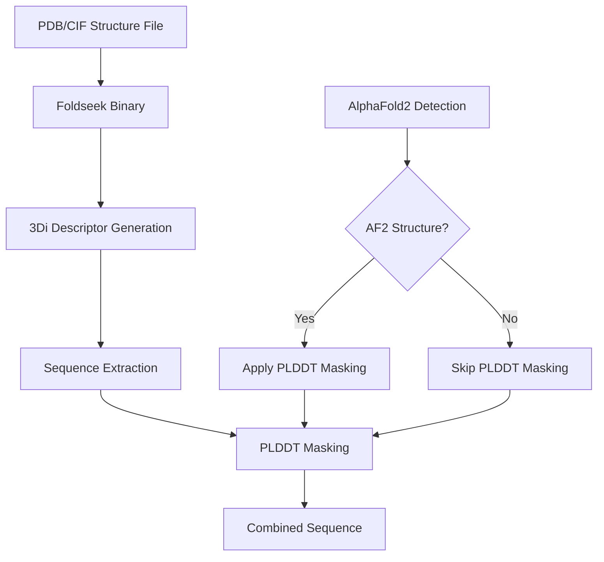

Foldseek integration in SaprotHub enables efficient protein structure analysis by converting 3D structural information into sequence-like representations that can be processed by transformer models. This documentation explores the architecture and implementation of Foldseek-based structure processing.

## Foldseek Integration Architecture

The Foldseek processing pipeline transforms protein structures into three complementary sequence representations that capture both sequential and structural information:



The core processing function `get_struc_seq()` [foldseek_util.py#L12-L88](saprot/utils/foldseek_util.py#L12-L88) orchestrates this transformation by calling the Foldseek binary with specific parameters for 3Di descriptor generation.

## Structural Sequence Generation

### Core Function Parameters

The `get_struc_seq()` function accepts several key parameters that control the processing behavior:

| Parameter | Type | Default | Description |
|-----------|------|---------|-------------|
| `foldseek` | str | Required | Path to Foldseek binary executable |
| `path` | str | Required | Path to PDB or CIF structure file |
| `chains` | list | None | Specific chains to extract (None = all chains) |
| `process_id` | int | 0 | Process ID for parallel processing |
| `plddt_mask` | bool | True | Enable PLDDT-based quality masking |
| `plddt_threshold` | float | 70.0 | Minimum PLDDT score for inclusion |
| `foldseek_verbose` | bool | False | Enable verbose Foldseek output |

### Output Format

The function returns a dictionary where each key represents a chain ID, and each value contains a tuple of three sequences:

- **Sequence**: Standard amino acid sequence
- **Structure Sequence**: Foldseek 3Di descriptor sequence  
- **Combined Sequence**: Interleaved amino acid and 3Di characters

```python
# Example output structure
seq_dict = {
    "A": (
        "MKTLLILAV...",           # Amino acid sequence
        "ABCD123456...",          # 3Di structure sequence  
        "MaBbKcCdD1..."           # Combined sequence
    )
}
```

> [!TIP]
> The combined sequence interleaves amino acid residues with their corresponding 3Di structure descriptors, creating a unified representation that preserves both sequence and structural information for transformer processing.

## PLDDT Quality Masking

### AlphaFold2 Detection

The system automatically detects AlphaFold2 structures by checking for "alphafold" in the file header [foldseek_util.py#L35-L36](saprot/utils/foldseek_util.py#L35-L36). This detection determines whether PLDDT masking should be applied, as experimental structures lack confidence scores.

### PLDDT Extraction Process

The `extract_plddt()` function [foldseek_util.py#L90-L125](saprot/utils/foldseek_util.py#L90-L125) handles confidence score extraction from both PDB and CIF formats:

```python
def extract_plddt(pdb_path: str) -> np.ndarray:
    # Parser selection based on file extension
    if pdb_path.endswith(".cif"):
        parser = MMCIFParser()
    elif pdb_path.endswith(".pdb"):
        parser = PDBParser()
    
    # Extract B-factors as PLDDT scores
    structure = parser.get_structure('protein', pdb_path)
    model = structure[0]
    chain = model["A"]
    
    plddts = []
    for residue in chain:
        residue_plddts = []
        for atom in residue:
            plddt = atom.get_bfactor()  # B-factor = PLDDT score
            residue_plddts.append(plddt)
        plddts.append(np.mean(residue_plddts))
    
    return np.array(plddts)
```

### Masking Implementation

Low-confidence regions (PLDDT < threshold) are masked with "#" characters in the structure sequence, effectively removing unreliable structural information from the model input [foldseek_util.py#L42-L52](saprot/utils/foldseek_util.py#L42-L52).

> [!TIP]
> The masking threshold of 70.0 balances structural information retention with quality control, removing regions where AlphaFold2 confidence is insufficient for reliable prediction.

## Integration with Model Pipeline

### Structure Feature Conversion

The Foldseek-generated sequences integrate with the broader Saprot pipeline through the `pdb2feature()` function [pdb2feature.py#L10-L16](saprot/data/pdb2feature.py#L10-L16), which converts PDB coordinates into tensor features compatible with transformer models.

### Chain Processing Support

The system supports multi-chain protein structures through the `parse_structure()` function [parse.py#L421-L473](saprot/data/parse.py#L421-L473), which can extract specific chains or process all chains in a structure:

```python
def parse_structure(path, chains: list = None, CA_only: bool = False) -> dict:
    # Returns dict of parsed chains with sequences and coordinates
    # Each chain contains: seq, coords, name, chain
```

## Usage Examples

### Basic Structure Processing

```python
from saprot.utils.foldseek_util import get_struc_seq

# Process a protein structure
foldseek_path = "/path/to/foldseek"
pdb_path = "/path/to/protein.pdb"

result = get_struc_seq(
    foldseek=foldseek_path,
    path=pdb_path,
    chains=["A", "B"],  # Process specific chains
    plddt_threshold=75.0,  # Higher quality threshold
    foldseek_verbose=True
)

# Access results
for chain_id, (seq, struct_seq, combined) in result.items():
    print(f"Chain {chain_id}: {combined[:50]}...")
```

### Parallel Processing

For large datasets, utilize the `process_id` parameter to enable parallel processing without file conflicts:

```python
import multiprocessing as mp

def process_structure(args):
    foldseek_path, pdb_path, proc_id = args
    return get_struc_seq(foldseek_path, pdb_path, process_id=proc_id)

with mp.Pool(processes=4) as pool:
    args = [(foldseek_path, pdb, i) for i, pdb in enumerate(pdb_files)]
    results = pool.map(process_structure, args)
```

## Error Handling and Validation

The system includes comprehensive validation:

1. **File Existence**: Verifies both Foldseek binary and structure files exist [foldseek_util.py#L19-L20](saprot/utils/foldseek_util.py#L19-L20)
2. **Format Support**: Supports both PDB and CIF file formats [parse.py#L426-L427](saprot/data/parse.py#L426-L427)
3. **PLDDT Validation**: Ensures PLDDT array length matches structure sequence length [foldseek_util.py#L45](saprot/utils/foldseek_util.py#L45)
4. **Graceful Degradation**: Continues processing even if PLDDT masking fails [foldseek_util.py#L53-L57](saprot/utils/foldseek_util.py#L53-L57)

## Next Steps

To fully leverage Foldseek processing in your Saprot workflow:

1. Review [Structure-Aware Protein Representation](6-structure-aware-protein-representation) for model integration details
2. Explore [Dataset Format Requirements](13-dataset-format-requirements) for input specifications
3. Consult [Transformer-Based Model Architecture](7-transformer-based-model-architecture) for sequence processing details