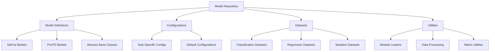

The SaprotHub Model Repository serves as a centralized hub for accessing and utilizing pre-trained protein models across various computational biology tasks. This repository provides a structured approach to model management, configuration, and deployment for protein structure-aware machine learning applications.

## Repository Architecture Overview

The model repository is organized around a modular architecture that separates concerns between model definitions, configurations, datasets, and utilities. This design enables flexible model selection and easy integration across different protein analysis tasks.



## Model Interface System

The repository employs a dynamic model loading system through the `ModelInterface` class [saprot/model/model_interface.py](saprot/model/model_interface.py#L89-L99). This system allows for flexible model instantiation based on configuration files, enabling users to switch between different model architectures without modifying code.

> [!TIP]
> The model interface uses Python's dynamic import capabilities to load models at runtime, making it possible to add new model types simply by creating new Python files and referencing them in configuration YAML files.

### Available Model Categories

| Model Type | Purpose | Configuration Examples |
|------------|---------|------------------------|
| Classification | Protein property classification | [DeepLoc](saprot/config/DeepLoc/cls2/saprot.yaml), [EC Number](saprot/config/EC/saprot.yaml) |
| Regression | Continuous value prediction | [Thermostability](saprot/config/Thermostability/saprot.yaml) |
| Mutation Analysis | Variant effect prediction | [ClinVar](saprot/config/ClinVar/saprot.yaml), [ProteinGym](saprot/config/ProteinGym/saprot.yaml) |
| Protein-Protein Interaction | Interaction prediction | [HumanPPI](saprot/config/HumanPPI/saprot.yaml) |

## Configuration Management

The repository uses a hierarchical configuration system where task-specific configurations inherit from a base configuration defined in [default.yaml](saprot/config/default.yaml). The [config_dict.py](saprot/config/config_dict.py) file serves as a centralized registry that loads all available configurations.

### Configuration Structure

Each configuration file follows a standardized structure:

```yaml
setting:    # Global settings and environment variables
model:      # Model-specific parameters and architecture
dataset:    # Data loading and preprocessing parameters
Trainer:    # PyTorch Lightning training configuration
```

The configuration system supports:
- **Environment variable management** for distributed training
- **Flexible model loading** through dynamic module paths
- **Dataset path configuration** for different data splits
- **Training hyperparameters** with sensible defaults

## Model Abstraction Layer

All models in the repository inherit from the `AbstractModel` class [saprot/model/abstract_model.py](saprot/model/abstract_model.py#L12), which provides a standardized interface for training, validation, and checkpointing. This abstraction ensures consistency across different model implementations and facilitates:

- **Unified training workflows** using PyTorch Lightning
- **Automatic checkpoint management** with best model tracking
- **Standardized metric logging** and evaluation
- **Flexible optimizer configuration** with custom learning rate schedulers

> [!TIP]
> The abstract model class enforces implementation of key methods like `initialize_model()`, `forward()`, and `loss_func()`, ensuring that all model implementations follow consistent patterns while allowing for task-specific customization.

## Task-Specific Model Implementations

### SaProt Model Family

The SaProt models [saprot/model/saprot/](saprot/model/saprot/) implement structure-aware protein representations, supporting various downstream tasks:

- **Classification models** for protein property prediction
- **Regression models** for continuous value estimation
- **Mutation effect models** for variant impact analysis
- **Inverse folding models** for sequence design

### ProtT5 Integration

The repository also supports ProtT5-based models [saprot/model/protT5/](saprot/model/protT5/), providing compatibility with existing protein language model workflows while maintaining the same training and evaluation infrastructure.

## Dataset Management

The repository includes a comprehensive dataset management system with:

- **LMDB-based data storage** for efficient large-scale dataset handling
- **Task-specific dataset classes** for different protein analysis tasks
- **Dynamic dataset loading** through the `DataInterface` class [saprot/dataset/data_interface.py](saprot/dataset/data_interface.py#L88-L99)
- **Preprocessing utilities** for protein structure and sequence data

## Utility Infrastructure

The [utils/](saprot/utils/) directory provides essential tools for:

- **Module loading** and dynamic instantiation [module_loader.py](saprot/utils/module_loader.py#L113-L140)
- **Protein structure processing** with Foldseek integration
- **Metric computation** and evaluation utilities
- **Data transformation** and preprocessing pipelines

## Usage Workflow

The typical workflow for using models from the repository involves:

1. **Select a task configuration** from the available YAML files
2. **Customize paths and parameters** as needed
3. **Load the model** using the module loader system
4. **Prepare datasets** following the specified format requirements
5. **Train or evaluate** using the standardized training scripts

This system enables researchers to quickly prototype and deploy protein analysis models without dealing with low-level implementation details, while still providing flexibility for customization and extension.

## Community Integration

The repository is designed to facilitate community contributions through:

- **Standardized model interfaces** that make adding new models straightforward
- **Configuration-driven model selection** that doesn't require code modifications
- **Comprehensive documentation** and example configurations
- **Modular architecture** that supports independent component development

For developers interested in contributing to the model ecosystem, the [Contributing to OPMC](16-contributing-to-opmc) and [Adapter-based Model Sharing](17-adapter-based-model-sharing) pages provide detailed guidelines for extending the repository with new models and sharing them with the community.