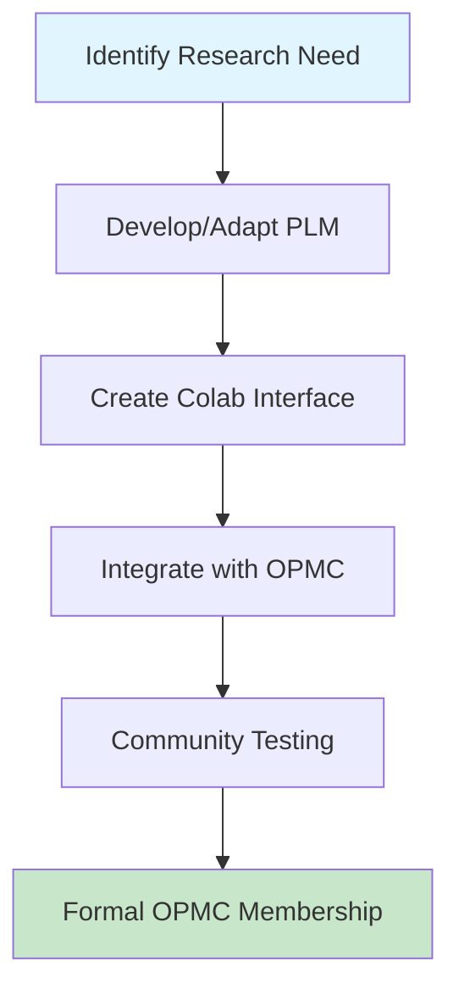

The Open Protein Modeling Consortium (OPMC) represents a collaborative vision to democratize protein language model development and sharing across the biology community. Contributing to OPMC offers opportunities to shape the future of protein AI research while gaining recognition for your innovations.

## Understanding OPMC's Mission

OPMC is founded on the principle of **decentralized model development** with **centralized resource sharing**. Unlike traditional approaches that silo research efforts, OPMC fosters a collaborative ecosystem where:

- **Individual researchers** can train specialized protein models tailored to their specific biological questions
- **Community members** can build upon existing models, creating a cumulative knowledge base
- **Biologists without ML backgrounds** gain access to powerful protein prediction tools through user-friendly interfaces

The consortium currently encompasses multiple protein language model platforms including ColabSaprot, ColabSeprot, ColabProtT5, and emerging tools like Evolla and ProTrek [README.md#L34-L50].

## Contribution Pathways

### 1. Model Development and Integration

The most significant contribution pathway involves developing new protein language models or adapting existing ones:



**Technical Requirements:**
- Follow the established SaprotHub architecture patterns using the `AbstractModel` class [saprot/model/abstract_model.py#L12-L105]
- Implement standardized interfaces for model loading via `ModelInterface` [saprot/model/model_interface.py#L89-L100]
- Ensure compatibility with the existing dataset and configuration systems

### 2. Platform Enhancement

Beyond model development, you can contribute through:

- **Interface Improvements**: Enhancing user experience for biologists
- **Documentation**: Creating tutorials and guides for specific use cases
- **Benchmark Development**: Establishing standardized evaluation protocols
- **Tool Integration**: Connecting OPMC with complementary bioinformatics resources

## Membership and Recognition

### OPMC Membership Tiers

| Contribution Type | Membership Level | Recognition | Timeline |
|-------------------|------------------|-------------|----------|
| Model Development | Full Member | Co-author on SaprotHub paper | Before final revision |
| Tool Enhancement | Associate Member | Acknowledged contributor | Ongoing |
| Community Support | Contributor | Listed in community resources | Quarterly review |

### Authorship Criteria

To qualify for authorship on the SaprotHub paper:

1. **Pre-Publication**: All OPMC members are automatically included as authors before the paper's final revision (4-12 month window) [README.md#L155-L160]
2. **Post-Publication**: New members can join OPMC but won't be listed as paper authors due to journal constraints [README.md#L162-L165]
3. **Independent PLMHubs**: Developers creating separate platforms (like ESMHub or ProtTransHub) can gain authorship by acknowledging OPMC framework origins [README.md#L60-L67]

## Technical Integration Process

### Step 1: Join SaprotHub Organization

Begin by joining the SaprotHub HuggingFace Organization to gain repository access [tutorial.md#L493-L500].

### Step 2: Model Integration

Choose your integration approach:

**Option A: Model Transfer (Recommended)**
- Upload your model using ColabSaprot
- Transfer directly to SaprotHub repository
- Benefits: Simplified process, immediate community access

**Option B: Manual Repository Creation**
- Create new model repository on SaprotHub
- Upload model files manually
- Benefits: Greater control over repository structure

### Step 3: Architecture Compliance

Ensure your model follows the established patterns:

```python
# Example: Extending the AbstractModel
class YourProteinModel(AbstractModel):
    def initialize_model(self):
        # Your model initialization logic
        self.model = YourModelArchitecture()
    
    def forward(self, batch):
        # Forward pass implementation
        return self.model(batch)
    
    def initialize_metrics(self, stage):
        # Task-specific metrics
        return {"accuracy": AccuracyMetric()}
```

## Quality Standards and Review

### Code Quality Requirements

- **Documentation**: Comprehensive docstrings for all public methods
- **Testing**: Unit tests covering core functionality
- **Compatibility**: Adherence to existing API contracts
- **Performance**: Reasonable computational efficiency for biological use cases

### Community Review Process

1. **Initial Assessment**: Technical compliance with OPMC standards
2. **Community Testing**: Beta testing by consortium members
3. **Integration Review**: Final approval by steering committee
4. **Formal Inclusion**: Official recognition as OPMC contribution

## Next Steps

Ready to contribute to OPMC? Here's your action plan:

1. **Explore Existing Models**: Study current implementations in [saprot/model/saprot/](saprot/model/saprot) to understand architectural patterns
2. **Identify Your Niche**: Determine what unique capabilities you can bring to the ecosystem
3. **Review Guidelines**: Examine the [contribution tutorial](tutorial.md#L489-L523) for detailed technical requirements
4. **Engage with Community**: Join discussion forums to connect with existing members

For specific implementation guidance, refer to [Adapter-based Model Sharing](17-adapter-based-model-sharing) or explore the [SaprotHub Model Repository](15-saprothub-model-repository) to see examples of successful integrations.

The future of protein AI research depends on collaborative innovation. By contributing to OPMC, you're not just sharing code—you're helping build a more accessible, powerful, and collaborative future for computational biology.