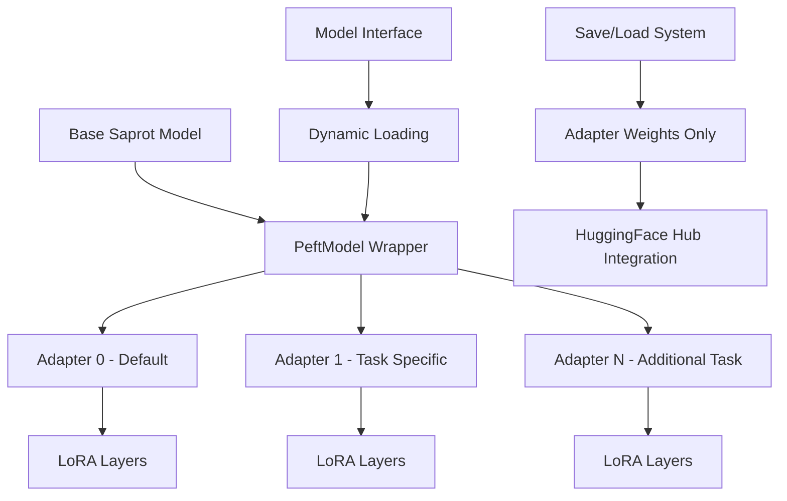

Adapter-based model sharing in SaprotHub provides an efficient mechanism for distributing and reusing specialized protein models without sharing the full backbone weights. This approach leverages Parameter-Efficient Fine-Tuning (PEFT) techniques, particularly LoRA (Low-Rank Adaptation), to enable lightweight model sharing and rapid task adaptation.

## Architecture Overview

The adapter system is built around a hierarchical architecture that separates the base protein language model from task-specific adapters:



The core architecture utilizes the `PeftModel` class from the custom PEFT implementation [saprot/model/saprot/self_peft/peft_model.py](saprot/model/saprot/self_peft/peft_model.py#L88), which wraps the base model and manages multiple adapters simultaneously.

## Adapter Management System

### Multi-Adapter Support

SaprotHub supports loading and managing multiple adapters within a single model instance. The system initializes adapters through the `_init_lora()` method [saprot/model/saprot/base.py](saprot/model/saprot/base.py#L74):

```python
for i in range(self.lora_kwargs.num_lora):
    adapter_name = f"adapter_{i}" if self.lora_kwargs.num_lora > 1 else "default"
```

Each adapter can be independently configured as either:
- **Pre-trained adapters**: Loaded from existing checkpoint files
- **Training adapters**: Initialized with new LoRA configurations

### Adapter Configuration

The LoRA configuration supports comprehensive customization through the `LoraConfig` class:

| Parameter | Default | Description |
|-----------|---------|-------------|
| `task_type` | "SEQ_CLS" | Task type for adapter specialization |
| `target_modules` | ["query", "key", "value", "intermediate.dense", "output.dense"] | Transformer layers to adapt |
| `modules_to_save` | ["classifier"] | Additional modules to train |
| `r` | 8 | LoRA rank (adaptation capacity) |
| `lora_alpha` | 16 | LoRA scaling parameter |
| `lora_dropout` | 0.0 | Dropout rate for LoRA layers |

> [!TIP]
> The `modules_to_save` parameter is crucial for task-specific components like classification heads, allowing these modules to be trained separately from the frozen backbone.

## Model Loading and Registration

### Dynamic Model Interface

The `ModelInterface` class provides dynamic model loading capabilities [saprot/model/model_interface.py](saprot/model/model_interface.py#L89):

```python
@classmethod
def init_model(cls, model_py_path: str, **kwargs):
    sub_dirs = model_py_path.split(os.sep)
    cmd = f"from {'.' + '.'.join(sub_dirs[:-1])} import {sub_dirs[-1]}"
    exec(cmd)
    return now_cls(**kwargs)
```

This system enables runtime model registration through the `@register_model` decorator, allowing new model implementations to be discovered and instantiated dynamically.

### Abstract Model Framework

All adapter-enabled models inherit from `SaprotBaseModel` [saprot/model/saprot/base.py](saprot/model/saprot/base.py#L21), which extends `AbstractModel` [saprot/model/abstract_model.py](saprot/model/abstract_model.py#L12) and provides:

- **Adapter initialization** through `_init_lora()`
- **Checkpoint management** with adapter-specific saving
- **Metrics tracking** for multi-adapter scenarios
- **Training orchestration** with adapter switching capabilities

## Adapter Persistence and Sharing

### Efficient Weight Serialization

The adapter system implements specialized state dict management that extracts only adapter-specific parameters:

```python
def get_peft_model_state_dict(model, state_dict=None, adapter_name="default"):
    # Extract only LoRA parameters
    to_return = {k: state_dict[k] for k in state_dict if "lora_" in k}
    # Handle bias parameters based on configuration
    # Process embedding layers if needed
```

This approach reduces model size dramatically, with typical adapters being only 1-5% of the full model size.

### HuggingFace Hub Integration

Adapters can be shared through the HuggingFace Hub using the `PushToHubMixin` functionality. The system supports:

- **Safe serialization** using safetensors format
- **Metadata preservation** including base model information
- **Version control** through adapter naming conventions
- **Automatic model card generation** with PEFT-specific details

### Loading Mechanisms

The system provides flexible adapter loading through multiple pathways:

1. **Local file loading**: Direct path specification
2. **Hub downloading**: Automatic retrieval from HuggingFace Hub
3. **Multi-adapter composition**: Loading multiple adapters simultaneously

> [!TIP]
> When loading multiple adapters, each maintains its own configuration and trainable parameters, enabling efficient multi-task learning and rapid task switching.

## Task-Specific Implementations

### Classification Models

The `SaprotClassificationModel` [saprot/model/saprot/saprot_classification_model.py](saprot/model/saprot/saprot_classification_model.py#L11) demonstrates adapter integration for classification tasks:

```python
def forward(self, inputs, coords=None):
    if coords is not None:
        inputs = self.add_bias_feature(inputs, coords)
    
    if self.freeze_backbone:
        # Use frozen backbone with adapter-enhanced representations
        repr = torch.stack(self.get_hidden_states_from_dict(inputs, reduction="mean"))
        # ... classification head processing
    else:
        logits = self.model(**inputs).logits
```

### Model Variants

The framework supports multiple task-specific model types:

- **Sequence Classification**: `SaprotClassificationModel`
- **Regression**: `SaprotRegressionModel`
- **Token Classification**: `SaprotTokenClassificationModel`
- **Pair Classification**: `SaprotPairClassificationModel`
- **Mutation Prediction**: `SaprotFoldseekMutationModel`
- **Inverse Folding**: `SaprotIFModel`

Each variant implements task-specific forward passes and loss functions while leveraging the common adapter infrastructure.

## Advanced Features

### Gradient Checkpointing Support

The system includes automatic gradient checkpointing setup for memory-efficient training:

```python
def _prepare_model_for_gradient_checkpointing(self, model: PreTrainedModel):
    # Configure gradient checkpointing for base model
    # Handle adapter-specific considerations
```

### Parameter Efficiency Tracking

Built-in utilities monitor parameter efficiency:

```python
def get_nb_trainable_parameters(self) -> tuple[int, int]:
    # Returns (trainable_params, total_params)
    
def print_trainable_parameters(self) -> None:
    # Displays percentage of trainable parameters
```

### Adapter Switching

Runtime adapter switching enables dynamic task adaptation:

```python
def set_adapter(self, adapter_name: str) -> None:
    # Activate specified adapter for inference/training
    
@contextmanager
def disable_adapter(self):
    # Temporarily disable all adapters
```

## Best Practices

### Adapter Design Guidelines

1. **Rank Selection**: Choose `r` values based on task complexity (typically 4-32)
2. **Target Module Selection**: Focus on attention and feed-forward layers
3. **Module Preservation**: Save task-specific heads separately
4. **Regularization**: Apply appropriate dropout to prevent overfitting

### Sharing Workflows

1. **Training**: Train adapters with frozen backbone
2. **Validation**: Evaluate adapter performance on held-out data
3. **Export**: Save adapter weights with metadata
4. **Distribution**: Share through HuggingFace Hub
5. **Loading**: Dynamic loading in downstream applications

### Performance Considerations

- **Memory Usage**: Adapters reduce GPU memory requirements by 90-95%
- **Training Speed**: Faster convergence due to fewer parameters
- **Inference Latency**: Minimal overhead compared to full fine-tuning
- **Storage Efficiency**: Dramatically reduced model sizes for distribution

## Integration with SaprotHub Ecosystem

The adapter system seamlessly integrates with other SaprotHub components:

- **Dataset Pipeline**: Compatible with all dataset formats
- **Training Scripts**: Full support in training workflows
- **Configuration System**: YAML-based adapter configuration
- **Evaluation Framework**: Adapter-specific metric tracking

This integration enables end-to-end workflows from data preparation through model sharing, making SaprotHub a comprehensive platform for protein AI research and application development.

For continued learning, explore [Multi-model Ensemble Prediction](11-multi-model-ensemble-prediction) to understand how adapters can be combined for enhanced performance, or review [SaprotHub Model Repository](15-saprothub-model-repository) for available pre-trained adapters.