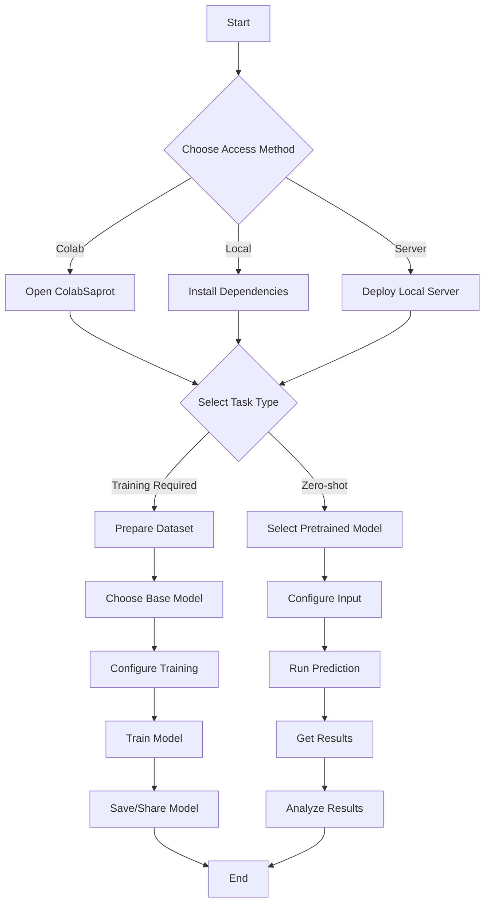

Welcome to SaprotHub - a revolutionary platform that democratizes protein language model training, sharing, and collaboration for the entire biology community. This guide will help you get started with protein modeling tasks in minutes, even without coding experience.

## What is SaprotHub?

SaprotHub is an official implementation of the [SaprotHub paper](https://www.biorxiv.org/content/10.1101/2024.05.24.595648v5) published in Nature Biotechnology. It enables biologists to train and share protein language models through a user-friendly interface, eliminating the need for advanced machine learning knowledge or coding skills.


## Getting Started in 3 Ways

### 1. Google Colab (Recommended for Beginners)

The fastest way to start is through Google Colab, which provides free GPU access:

#### Access Options:
- **[ColabSaprot](https://colab.research.google.com/github/westlake-repl/SaprotHub/blob/main/colab/SaprotHub_v2.ipynb)** - Structure-aware protein models (35M, 650M)
- **[ColabSeprot](https://colab.research.google.com/github/westlake-repl/SaprotHub/blob/main/colab/ColabSeprot.ipynb)** - Sequence-based models including ESM1b, ESM2, ProtBert, ProTrek

#### Setup Steps:
1. Open the Colab notebook link
2. Switch to GPU runtime: `Runtime > Change runtime type > GPU`
3. Click the run button to start the installation (3-8 minutes)

#### GPU Selection Guide:
| GPU Type | Cost | Best For | Model Size |
|----------|------|----------|------------|
| T4 | Free | Basic tasks, small datasets | Saprot 35M |
| L4 | Colab Pro | Medium datasets | Saprot 650M |
| A100 | Colab Pro | Large datasets, complex tasks | Saprot 650M |

### 2. Local Server Deployment

For users who prefer local deployment:

#### Linux Users:
```bash
cd local_server
bash install.sh
bash run.sh
```

#### Windows Users:
1. Download [SaprotHubImage.tar](https://huggingface.co/datasets/lxzcpro/SaprotHubWindowsDeploy/tree/main) and WindowsDeploy.bat
2. Install [Docker Desktop](https://desktop.docker.com/win/main/amd64/Docker%20Desktop%20Installer.exe)
3. Run WindowsDeploy.bat
4. Start Jupyter: `bash run.sh`

#### Connection:
Connect to `http://localhost:12315/?token=SaprotHub` through Colab's "Connect to local runtime" option.

### 3. Local Installation

For advanced users who want to integrate SaprotHub into their workflows:

```bash
# Install dependencies
pip install -r requirements.txt

# Or using Poetry
pip install poetry
poetry install
```

[pyproject.toml](pyproject.toml#L1-L34) and [requirements.txt](requirements.txt#L1-L26) contain all necessary dependencies including PyTorch, transformers, and specialized bioinformatics libraries.

## Understanding Your Tasks

SaprotHub supports various protein prediction tasks. Understanding your task type is crucial for selecting the right approach:

### Classification & Regression Tasks (Training Required)

| Task Type | Description | Examples |
|-----------|-------------|----------|
| **Protein-level Classification** | Classify entire protein sequences | Fold prediction, localization, function prediction |
| **Protein-level Regression** | Predict numerical protein properties | Thermal stability, fluorescence intensity, binding affinity |
| **Residue-level Classification** | Classify individual amino acids | Secondary structure, binding sites, active sites |
| **Pair Classification** | Predict protein-protein interactions | PPI prediction, interaction type classification |
| **Pair Regression** | Predict interaction strength | Binding energy, interaction affinity |

### Zero-shot Tasks (No Training Required)

| Task Type | Description | Examples |
|-----------|-------------|----------|
| **Mutational Effect Prediction** | Predict effects of mutations | Enzyme activity, virus fitness, driver mutations |
| **Inverse Folding** | Predict sequences from structures | Enzyme optimization, stability enhancement |

## Data Preparation

### Supported Data Formats

SaprotHub accepts multiple data types:

#### Single Protein Input:
- AA Sequences (FASTA format)
- SA Sequences (Structure-aware sequences)
- UniProt IDs
- PDB/CIF Structure files

#### Batch Input:
- Multiple AA/SA sequences (CSV format)
- Multiple UniProt IDs (CSV format)
- Multiple PDB/CIF structures (CSV + ZIP)

#### Pair Input (for interaction tasks):
- Pairs of any single input type above

### Structure-Aware (SA) Sequences

SA sequences combine residue and structural information using Foldseek encoding:


### Dataset Format Requirements

For training tasks, prepare a CSV file with three required columns:

| Column | Description | Example |
|--------|-------------|---------|
| `sequence` | Protein data based on your data type | `MKTLLL...` or SA sequence |
| `label` | Task-specific labels | `0,1,2` (classification) or `1.23` (regression) |
| `stage` | Data split | `train`, `valid`, `test` |

## Model Selection

### Available Model Types

| Model Type | Use Case | Description |
|------------|----------|-------------|
| **Official SaProt 35M** | Training | Lightweight model for quick experiments |
| **Official SaProt 650M** | Training | Full-featured model for best performance |
| **Self-trained Models** | Continual training/prediction | Models you've trained on ColabSaprot |
| **SaprotHub Community Models** | Continual training/prediction | Models shared by the community |
| **Local Models** | Continual training/prediction | Models saved to your computer |
| **Multi-model Ensembles** | Prediction | Combine multiple models for better accuracy |

### Finding Community Models

1. Visit [SaprotHub Repository](https://huggingface.co/SaProtHub)
2. Browse models by task, performance, or popularity
3. Copy the Model ID for use in ColabSaprot

## Quick Workflow



## Training Configuration

For training tasks, configure these key parameters:

| Parameter | Recommended Values | Description |
|-----------|-------------------|-------------|
| `batch_size` | Adaptive (default) or 8-256 | Depends on dataset size and GPU memory |
| `max_epochs` | 10-50 | Maximum training iterations |
| `learning_rate` | 5.0e-4 (650M) or 1.0e-3 (35M) | Convergence speed control |

> [!TIP]
> Start with smaller `max_epochs` (10-20) and monitor validation performance. The best model is saved after each epoch automatically.

## Community and Support

### Getting Help:
- **Email**: {sujin, yuanfajie}@westlake.edu.cn (24-hour response time)
- **Slack**: [Join our community](https://westlakeai.slack.com/archives/C08JNBN40P7)
- **WeChat**: Scan QR code in README for group access (500+ members)

### Contributing to OPMC:
SaprotHub is part of the [Open Protein Modeling Consortium (OPMC)](https://theopmc.github.io/). You can contribute by:
- Training and sharing models on SaprotHub
- Developing new ColabPLM interfaces
- Joining as an OPMC member for authorship opportunities

## Next Steps

Now that you understand the basics, explore these specific guides:

- [Understanding Protein Prediction Tasks](3-understanding-protein-prediction-tasks) - Deep dive into task types and applications
- [Preparing Your Dataset](4-preparing-your-dataset) - Detailed dataset preparation instructions
- [Choosing the Right Model](5-choosing-the-right-model) - Model selection strategies and comparisons

Ready to start? Open [ColabSaprot](https://colab.research.google.com/github/westlake-repl/SaprotHub/blob/main/colab/SaprotHub_v2.ipynb) and begin your protein modeling journey!