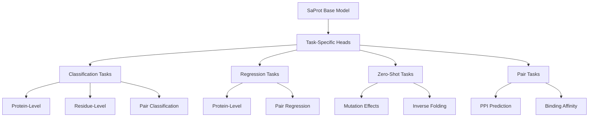

Protein prediction tasks form the foundation of computational biology and drug discovery, enabling researchers to understand protein functions, interactions, and properties without expensive wet-lab experiments. SaprotHub provides a comprehensive platform for various protein prediction tasks, leveraging the power of structure-aware protein language models to deliver accurate predictions across multiple biological applications.

## Task Categories Overview

SaprotHub supports protein prediction tasks organized into seven main categories, each addressing specific biological questions and applications:

Based on the comprehensive task list defined in [task_list.md](task_list.md#L1-L144), these categories encompass the full spectrum of protein analysis needs:

## Protein-Level Classification Tasks

Protein-level classification tasks categorize entire protein sequences into predefined classes based on their properties or functions. These tasks are fundamental for understanding protein behavior and biological roles.

**Key Applications:**
- **Fold Class Prediction**: Determining the structural fold category of proteins
- **Localization Prediction**: Predicting subcellular localization (e.g., nucleus, cytoplasm, membrane)
- **Function Prediction**: Classifying proteins based on their biological functions
- **Enzyme Classification**: Assigning Enzyme Commission (EC) numbers to enzymes
- **Domain Classification**: Identifying protein domain types and architectures

**Implementation in SaprotHub:**
The platform supports protein-level classification through specialized models like the DeepLoc classifier, which can predict subcellular localization with 2-class (cytoplasmic vs non-cytoplasmic) or 10-class configurations [saprot/config/DeepLoc/cls2/saprot.yaml](saprot/config/DeepLoc/cls2/saprot.yaml#L1-L70).

## Protein-Level Regression Tasks

Regression tasks predict continuous numerical values associated with protein properties, enabling quantitative assessment of protein characteristics.

**Key Applications:**
- **Thermal Stability Prediction**: Estimating protein melting temperatures
- **Binding Affinity Prediction**: Measuring interaction strength between proteins and ligands
- **Enzymatic Activity Prediction**: Quantifying catalytic efficiency
- **Solubility Prediction**: Assessing protein solubility properties
- **Expression Level Prediction**: Estimating protein expression yields

**Technical Implementation:**
These tasks utilize regression models that output continuous values, typically trained on datasets with numerical labels representing the target property [tutorial.md](tutorial.md#L200-L210).

## Protein-Protein Interaction Tasks

These tasks analyze relationships between protein pairs, crucial for understanding cellular pathways and drug target identification.

**Classification Applications:**
- **Protein-Protein Interaction (PPI) Prediction**: Determining whether two proteins interact
- **Interaction Type Classification**: Categorizing interaction mechanisms
- **Disease-Associated Interaction Prediction**: Identifying interactions linked to diseases

**Regression Applications:**
- **Interaction Strength Prediction**: Quantifying binding affinity
- **Binding Free Energy Calculation**: Computing thermodynamic parameters
- **Interaction Kinetics Prediction**: Estimating rate constants

## Zero-Shot Mutation Effect Prediction

This advanced category uses pre-trained models to predict the effects of mutations without task-specific training, leveraging the model's learned biological knowledge.

**Applications:**
- **Pathogenicity Prediction**: Assessing disease-causing potential of mutations
- **Protein Stability Prediction**: Estimating stability changes upon mutation
- **Enzyme Activity Prediction**: Predicting functional impact of mutations
- **Immune Escape Prediction**: Identifying mutations that evade immune detection

**SaprotHub Implementation:**
The ClinVar configuration demonstrates zero-shot prediction capabilities, using the SaProt model to predict mutational effects without fine-tuning [saprot/config/ClinVar/saprot.yaml](saprot/config/ClinVar/saprot.yaml#L1-L38).

## Protein Sequence Design

This forward-looking category focuses on generating novel protein sequences with desired properties, enabling protein engineering and drug design.

**Applications:**
- **Enzyme Function Optimization**: Designing enzymes with improved catalytic properties
- **Protein Stability Enhancement**: Creating more stable protein variants
- **Antibody Design**: Engineering therapeutic antibodies
- **Vaccine Design**: Developing immunogenic protein sequences

## Residue-Level Classification Tasks

These tasks perform fine-grained analysis at the amino acid level, providing detailed insights into protein structure and function.

**Applications:**
- **Secondary Structure Prediction**: Classifying residues into helix, sheet, or coil
- **Binding Site Prediction**: Identifying ligand-binding residues
- **Active Site Prediction**: Locating catalytic residues
- **Post-Translational Modification Site Prediction**: Identifying modification sites
- **Metal Binding Site Prediction**: Finding metal-coordinating residues

## Task Architecture in SaprotHub

The platform employs a unified architecture that supports different task types through specialized model configurations:

## Model Selection by Task Type

Different tasks require different model architectures and training strategies:

| Task Category | Model Type | Input Format | Output Type |
|---------------|------------|--------------|-------------|
| Protein Classification | Classification Model | Single Sequence | Class Labels |
| Protein Regression | Regression Model | Single Sequence | Continuous Values |
| Residue Classification | Sequence Tagging Model | Single Sequence | Per-Residue Labels |
| PPI Prediction | Pair Classification Model | Sequence Pair | Binary/Multi-class |
| Mutation Effects | Zero-shot Model | Wild-type + Mutation | Effect Scores |
| Sequence Design | Generative Model | Structure/Constraints | Novel Sequences |

## Data Requirements and Formats

Each task type has specific data requirements:

**For Classification/Regression Tasks:**
- CSV format with `sequence`, `label`, and `stage` columns
- Sequence format varies by data type (AA sequence, SA sequence, UniProt ID, PDB structure)
- Labels depend on task type (categorical indices for classification, numerical values for regression)

**For Zero-Shot Tasks:**
- Wild-type sequence and mutation information
- No training data required
- Uses pre-trained model knowledge

**For Pair Tasks:**
- Two protein sequences or structures per sample
- Interaction labels or affinity values

> [!TIP]
> The choice between different task types depends on your biological question and available data. Start with simpler classification tasks if you're new to protein prediction, then progress to more complex regression or zero-shot tasks as you gain experience.

## Next Steps

After understanding the available protein prediction tasks, you should:

1. **[Preparing Your Dataset](4-preparing-your-dataset)**: Learn how to format your data according to task requirements
2. **[Choosing the Right Model](5-choosing-the-right-model)**: Select appropriate model architecture for your specific task
3. **[Structure-Aware Protein Representation](6-structure-aware-protein-representation)**: Understand how Saprot processes protein structure information

Each task type in SaprotHub is supported by comprehensive documentation, example datasets, and pre-configured models to help you get started quickly with your protein analysis projects.