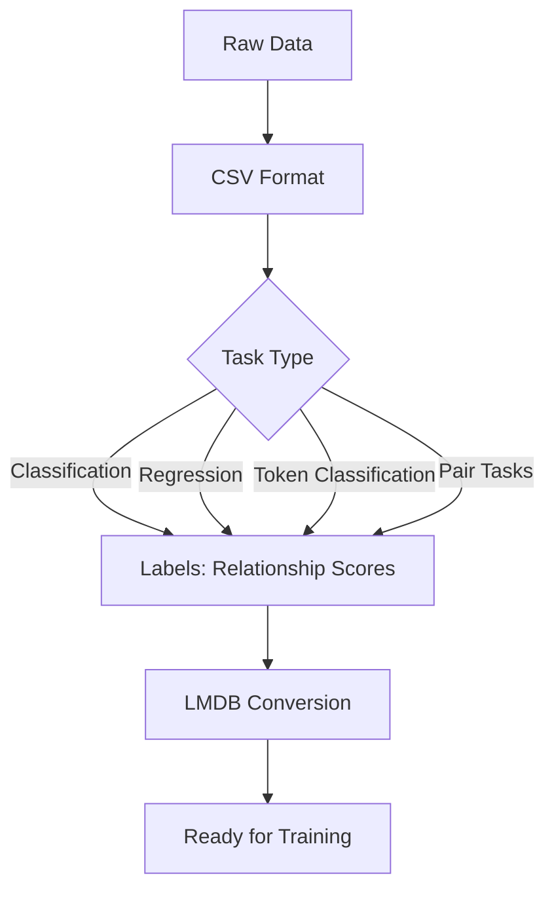

Understanding how to properly prepare your dataset is crucial for successful protein analysis with SaprotHub. This guide will walk you through the essential steps and formats needed to structure your data effectively.

## Dataset Structure Overview

SaprotHub supports multiple dataset formats designed for different protein analysis tasks. The system is built around a flexible LMDB (Lightning Memory-Mapped Database) infrastructure that enables efficient data handling for large-scale protein datasets.



## Supported Input Formats

### CSV Dataset Structure

Your primary input should be formatted as CSV files with specific column requirements. The system automatically processes these into LMDB format for optimal performance.

**Basic Structure Requirements:**
- `sequence`: Protein amino acid sequences
- `label`: Target values for your specific task
- `stage`: Data partition (train/valid/test)

### Task-Specific Formats

#### Classification Tasks
For protein classification, your dataset should include integer labels representing different categories:

```csv
sequence,label,stage
MEETMKLATMEDTVEYCLFLIPDESRDSDKHKEILQKYIERIITRFAPMLVPYIWQNQPFNLKYKPGKGGVPAHMFGVTKFGDNIEDEWFIVYVIKQITKEFPELVARIEDNDGEFLLIEAADFLPKWLDPENSTNRVFFCHGELCIIPAPRKSGAESWLPTTPPTIPQALNIITAHSEKILASESIRAAVNRRIRGYPEKIQASLHRAHCFLPAGIVAVLKQRPRLVAAAVQAFYLRDPIDLRACRVFKTFLPETRIMTSVTFTKCLYAQLVQQRFVPDRRSGYRLPPPSDPQYRAHEL,0,train
MAVMAPRTLLLLLSGALALTQTWAGSHSMRYFFTSVSRPGRGEPRFIAVGYVDDTQFVRFDSDAASQRMEPRAPWIEQEGPEYWDQETRNVKAQSQTDRVDLGTLRGYYNQSEAGSHTIQIMYGCDVGSDGRFLRGYRQDAYDGKDYIALNEDLRSWTAADMAAQITKRKWEAAHEAEQLRAYLDGTCVEWLRRYLENGKETLQRTDPPKTHMTHHPISDHEATLRCWALGFYPAEITLTWQRDGEDQTQDTELVETRPAGDGTFQKWAAVVVPSGEEQRYTCHVQHEGLPKPLTLRWEL,1,test
```

#### Regression Tasks
For regression analysis, labels should be continuous float values representing measurements like fitness scores or binding affinities.

#### Pair-Based Tasks
For protein-protein interaction or comparative tasks, the format expands to include paired sequences:

```csv
sequence_1,sequence_2,name_1,name_2,chain_1,chain_2,label,stage
MKVLWAALLVTFLAGCQAKVEQAVETEPEPELRQQTEWD... ,MVLSEGEWQLVLHVWAKVEADVAGHGQDILIRLFKSHPETLEKFDRVKHLKTEAEMKASEDLKKHGVTVLTALGAILKKKGHHEAELKPLAQSHATKHKIPIKYLEFISEAIIHVLHSRHPGDFGADAQGAMNKALELFRKDIAAKYKELGYQG,protein1,protein2,A,B,0.85,train
```

## Data Processing Pipeline

### Automatic LMDB Conversion

SaprotHub provides automated tools to convert your CSV files into optimized LMDB format. The `construct_lmdb` function handles this transformation efficiently:

```python
from saprot.utils.construct_lmdb import construct_lmdb

# Convert your CSV to LMDB format
construct_lmdb(
    csv_file="path/to/your/dataset.csv",
    root_dir="output/directory",
    dataset_name="my_protein_dataset",
    task_type="classification"
)
```

The system automatically validates your data format and handles different task types appropriately.

### Sequence Length Management

The framework includes intelligent sequence truncation to manage computational resources:

- Training sequences: Limited to 2044 amino acids for memory efficiency
- Validation/Test sequences: Full length preserved for complete evaluation
- Token classification: Labels truncated to 1022 positions during training

## Advanced Dataset Features

### Structure-Aware Datasets

For tasks requiring structural information, SaprotHub supports specialized datasets that incorporate 3D protein coordinates:

- **SaprotLMDataset**: Combines sequence masking with structural bias features
- **SaprotFoldseekDataset**: Uses Foldseek-based structural representations
- Coordinate data is processed through the protein structure parser for optimal encoding

### Data Transformation Utilities

The framework provides comprehensive data transformation tools:

- **One-hot encoding**: For sequence representation
- **Distance maps**: Spatial relationship calculations between residues
- **Orientation features**: 3D structural information extraction
- **RBF (Radial Basis Function) encoding**: Continuous value discretization

## Best Practices for Dataset Preparation

### Quality Assurance

1. **Sequence Validation**: Ensure all amino acid sequences use standard 20 amino acid notation
2. **Label Consistency**: Verify label types match your task (integers for classification, floats for regression)
3. **Data Partitioning**: Maintain balanced train/validation/test splits
4. **Missing Data Handling**: Address gaps in sequences or labels before processing

### Performance Optimization

1. **Batch Size Consideration**: Larger datasets benefit from LMDB's memory-mapped architecture
2. **Sequence Length**: Consider truncation strategies for very long proteins
3. **Storage Planning**: LMDB files typically require 2-3x the original CSV size

### Example Dataset Files

The repository includes comprehensive examples in the `upload_files/example_csv_dataset/train/` directory:

- `[EXAMPLE]Multiple_AA_Sequences.csv`: Basic sequence classification format
- `[EXAMPLE][Classification-2Categories]Multiple_AA_Sequences.csv`: Binary classification example
- `[EXAMPLE][Regression]Multiple_AA_Sequences.csv`: Regression task format
- `[EXAMPLE]Multiple_pairs_of_AA_Sequences.csv`: Protein-pair analysis format

## Integration with Training Pipeline

Once your dataset is properly formatted and converted to LMDB, it integrates seamlessly with SaprotHub's training infrastructure. The dataset interface automatically handles:

- Data loading and batching
- Tokenization and masking for language model training
- Coordinate processing for structure-aware tasks
- Multi-GPU data distribution

## Next Steps

After preparing your dataset, you'll want to explore [Choosing the Right Model](5-choosing-the-right-model) to select the optimal SaprotHub configuration for your specific protein analysis task. The model selection process considers your dataset characteristics, task requirements, and available computational resources.

For detailed information about specific dataset format requirements and advanced processing options, refer to [Dataset Format Requirements](13-dataset-format-requirements) in the comprehensive documentation.