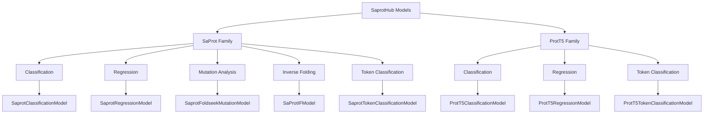
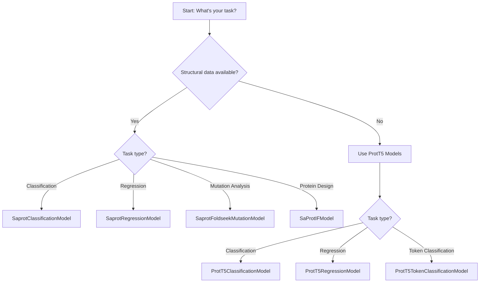

Selecting the appropriate model is crucial for achieving optimal performance in your protein prediction tasks. SaprotHub provides a comprehensive suite of models designed for different types of protein analysis, from sequence-only predictions to structure-aware computations. This guide will help you understand the available model options and choose the one that best fits your specific requirements.

## Model Architecture Overview

SaprotHub is built around two main model families: **SaProt** (structure-aware protein models) and **ProtT5** (sequence-based protein models). Each family offers specialized implementations for different downstream tasks.



## Model Selection Matrix

| Task Type | SaProt Model | ProtT5 Model | Structure Required | Best For |
|-----------|-------------|--------------|-------------------|----------|
| **Protein Classification** | SaprotClassificationModel | ProtT5ClassificationModel | Optional (SaProt) | Multi-class protein labeling, functional prediction |
| **Property Regression** | SaprotRegressionModel | ProtT5RegressionModel | Optional (SaProt) | Thermostability, binding affinity prediction |
| **Mutation Effect Prediction** | SaprotFoldseekMutationModel | ❌ | Required | Zero-shot mutational scanning, variant analysis |
| **Inverse Folding** | SaProtIFModel | ❌ | Required | Sequence design from structure |
| **Token Classification** | SaprotTokenClassificationModel | ProtT5TokenClassificationModel | Optional (SaProt) | Per-residue annotation, binding site prediction |

## SaProt Models: Structure-Aware Protein Analysis

### Classification Tasks

**SaprotClassificationModel** is designed for multi-class protein classification tasks. It leverages both sequence and structural information when available, making it ideal for tasks like:

- Enzyme commission (EC) number prediction
- Gene Ontology (GO) term classification
- Subcellular localization prediction
- Protein family classification

The model supports both frozen backbone and fine-tuning modes, allowing you to choose between efficient feature extraction and full model adaptation [saprot/model/saprot/saprot_classification_model.py](saprot/model/saprot/saprot_classification_model.py#L24-L40).

### Regression Tasks

**SaprotRegressionModel** handles continuous value prediction tasks. It's particularly effective for:

- Protein thermostability prediction
- Binding affinity estimation
- Expression level prediction
- Activity measurement

The model provides comprehensive metrics including Spearman correlation, Pearson correlation, and R² score for thorough performance evaluation [saprot/model/saprot/saprot_regression_model.py](saprot/model/saprot/saprot_regression_model.py#L20-L24).

### Mutation Effect Analysis

**SaprotFoldseekMutationModel** is the flagship model for zero-shot mutational effect prediction. Key features include:

- **Foldseek Integration**: Converts 3D structures to structural sequences for efficient processing
- **Confidence-based Masking**: Automatically masks low-confidence regions based on pLDDT scores
- **MSA Support**: Incorporates multiple sequence alignment information when available
- **Comprehensive Logging**: Tracks predictions for clinical variants and research datasets

This model excels at predicting the effects of single and multiple mutations without task-specific training [saprot/model/saprot/saprot_foldseek_mutation_model.py](saprot/model/saprot/saprot_foldseek_mutation_model.py#L136-L281).

### Inverse Folding

**SaProtIFModel** specializes in protein inverse folding - designing amino acid sequences that fold into desired 3D structures. It supports:

- **Multiple Prediction Methods**: Argmax for deterministic predictions or multinomial sampling for diverse sequence generation
- **Partial Masking**: Predict only specific regions while preserving others
- **Batch Processing**: Generate multiple sequence candidates simultaneously

This model is essential for protein design applications and structure-based sequence optimization [saprot/model/saprot/saprot_if_model.py](saprot/model/saprot/saprot_if_model.py#L77-L130).

## ProtT5 Models: Sequence-Based Protein Analysis

When structural information is unavailable or when you prefer sequence-only approaches, ProtT5 models provide excellent alternatives:

### ProtT5 Classification

**ProtT5ClassificationModel** offers sequence-based classification with strong performance on tasks where structural information may be less critical. It uses the ProtT5-XL-U50 pretrained model as its foundation [saprot/model/protT5/protT5_classification_model.py](saprot/model/protT5/protT5_classification_model.py#L36-L58).

### ProtT5 Regression

**ProtT5RegressionModel** provides sequence-based regression capabilities, suitable for property prediction when only sequence data is available.

## Configuration and Usage

### Model Configuration

All models in SaprotHub follow a unified configuration system based on YAML files. The default configuration template is located at [saprot/config/default.yaml](saprot/config/default.yaml), with task-specific configurations available in subdirectories:

- **Structure-aware tasks**: Use configurations in task-specific folders (e.g., `saprot/config/DeepLoc/`)
- **Pretrained models**: Available in `saprot/config/pretrain/`

### Key Configuration Parameters

```yaml
model:
  kwargs:
    load_pretrained: True  # Load pretrained weights
    # num_labels: 2        # Number of output classes (for classification)
  
dataset:
  kwargs:
    plddt_threshold: null  # Confidence threshold for structure masking
    
Trainer:
  max_epochs: 2          # Training epochs
  precision: 16          # Mixed precision training
```

## Decision Guidelines

### Choose SaProt Models When:

1. **High-accuracy prediction is critical** and you have structural data
2. **Working with mutation effects** or variant analysis
3. **Designing proteins** with specific structural constraints
4. **Analyzing structure-function relationships**

### Choose ProtT5 Models When:

1. **Only sequence data is available**
2. **Computational resources are limited** (faster inference)
3. **Working with large-scale sequence datasets**
4. **Structure information is less relevant** to your task

### Model Selection Flowchart



## Next Steps

After selecting your model, proceed to:

1. **[Understanding Protein Prediction Tasks](3-understanding-protein-prediction-tasks)** - Learn about the theoretical foundations
2. **[Structure-Aware Protein Representation](6-structure-aware-protein-representation)** - Deep dive into SaProt's architecture
3. **[Transformer-Based Model Architecture](7-transformer-based-model-architecture)** - Understand the underlying transformer mechanisms

> [!TIP]
> For beginners, start with the classification models as they have the most straightforward setup and comprehensive documentation. The SaprotClassificationModel provides an excellent introduction to structure-aware protein analysis.

> [!TIP]
> When working with mutation analysis, the SaprotFoldseekMutationModel offers the most comprehensive approach, supporting both single and multiple mutations with confidence-based structural masking.