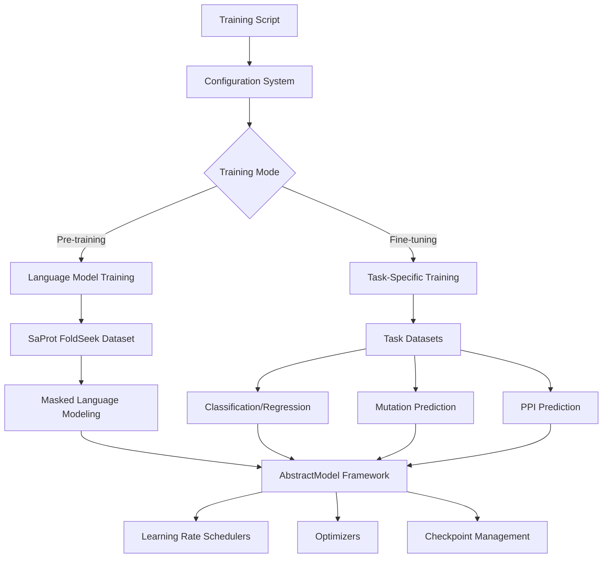

The Saprot framework implements a comprehensive training architecture that supports both large-scale pre-training and task-specific fine-tuning for structure-aware protein language models. This documentation outlines the strategic approaches, configurations, and implementation patterns that enable effective model development across various protein prediction tasks.

## Training Architecture Overview

Saprot employs a unified training framework built on PyTorch Lightning that abstracts the complexities of both pre-training and fine-tuning workflows. The architecture follows a modular design where different model types, datasets, and training strategies can be seamlessly integrated through configuration files.



## Pre-training Strategy

### Core Configuration

The pre-training strategy is designed for large-scale language model training on protein sequences with structural information. The primary configuration ([saprot/config/pretrain/saprot.yaml](saprot/config/pretrain/saprot.yaml#L1-L82)) establishes the foundation for self-supervised learning:

**Model Configuration:**
- **Model Path**: `saprot/saprot_lm_model` for language modeling
- **Base Configuration**: `westlake-repl/SaProt_35M_AF2` 
- **Pretrained Loading**: Disabled (`load_pretrained: False`) for training from scratch
- **Checkpoint Saving**: `/content/saprot/weights/Pretrain/SaProt_35M_AF2.pt`

**Learning Rate Schedule:**
The pre-training employs the ESM2-style learning rate scheduler ([saprot/utils/lr_scheduler.py](saprot/utils/lr_scheduler.py#L108-L187)) with the following parameters:
- **Initial LR**: 0.0 
- **Maximum LR**: 4.0e-4
- **Final LR**: 4.0e-5
- **Warmup Steps**: 2,000
- **Decay Range**: 150,000 to 1,500,000 steps

**Training Parameters:**
- **Maximum Steps**: 1,000,000
- **Batch Size**: 1 (gradient accumulation handled separately)
- **Precision**: 16-bit mixed precision
- **Mask Ratio**: 0.15 for masked language modeling

### Dataset Processing

The pre-training utilizes the Saprot FoldSeek dataset ([saprot/dataset/saprot/saprot_foldseek_dataset.py](saprot/dataset/saprot/saprot_foldseek_dataset.py)) which processes protein sequences with structural embeddings:

- **Data Source**: AF2_Uniref50 database with Foldseek structural encodings
- **Tokenization**: SaProt-specific tokenizer integrating sequence and structure
- **Maximum Length**: 1024 tokens
- **LMDB Storage**: Efficient data loading for large-scale training

## Fine-tuning Strategies

### Task-Specific Adaptation

Fine-tuning adapts the pre-trained model to specific downstream tasks through specialized configurations. The framework supports multiple task types:

**Classification Tasks:**
- **DeepLoc**: Protein subcellular localization (2-class and 10-class)
- **EC**: Enzyme commission number prediction
- **GO**: Gene ontology terms (BP, CC, MF branches)
- **MetalIonBinding**: Metal ion binding site prediction

**Regression Tasks:**
- **Thermostability**: Protein stability prediction
- **ProteinGym**: Fitness landscape prediction

**Specialized Tasks:**
- **ClinVar**: Clinical variant effect prediction
- **HumanPPI**: Protein-protein interaction prediction

### Configuration Patterns

Each fine-tuning task follows a consistent configuration pattern while adapting to specific requirements:

**Model Loading:**
```yaml
model:
  model_py_path: saprot/saprot_classification_model  # Task-specific model
  kwargs:
    config_path: westlake-repl/SaProt_35M_AF2
    load_pretrained: True  # Load pre-trained weights
    num_labels: 2  # Task-specific output dimension
```

**Learning Rate Strategy:**
Fine-tuning typically uses conservative learning rates:
- **Constant LR**: 2.0e-5 for most classification tasks
- **Scheduler**: Often disabled (`on_use: false`) for stability
- **Training Epochs**: 2-5 epochs to prevent overfitting

**Dataset Configuration:**
Each task uses specialized dataset classes with appropriate data processing:
- **Classification**: `saprot_classification_dataset`
- **Mutation**: `mutation_zeroshot_dataset`
- **PPI**: `saprot_ppi_dataset`

> [!TIP]
> The fine-tuning configurations maintain the same tokenizer and structural processing pipeline as pre-training, ensuring consistent feature representation across tasks while allowing task-specific model heads.

## Learning Rate Scheduling

### ESM2 Scheduler

The ESM2-style scheduler ([saprot/utils/lr_scheduler.py](saprot/utils/lr_scheduler.py#L108-L187)) implements a three-phase learning rate schedule:

1. **Warmup Phase** (0 to `warmup_steps`): Linear increase from `init_lr` to `max_lr`
2. **Constant Phase** (`warmup_steps` to `start_decay_after_n_steps`): Maintain `max_lr`
3. **Decay Phase** (`start_decay_after_n_steps` to `end_decay_after_n_steps`): Linear decay to `final_lr`

**Mathematical Formulation:**
- Warmup: `lr = init_lr + (step/warmup_steps) * (max_lr - init_lr)`
- Decay: `lr = max_lr - portion * (max_lr - final_lr)`

### Alternative Schedulers

**Constant Scheduler:**
Maintains fixed learning rate throughout training, suitable for fine-tuning scenarios where stability is prioritized over adaptation speed.

**Cosine Annealing:**
Provides smooth decay following cosine curve, useful for scenarios requiring gradual learning rate reduction.

## Training Infrastructure

### Optimization Strategy

The framework implements sophisticated optimization strategies ([saprot/model/abstract_model.py](saprot/model/abstract_model.py#L350-L399)):

**Parameter Grouping:**
- **Decay Parameters**: All weights except LayerNorm and bias terms
- **No-Decay Parameters**: LayerNorm weights and bias terms
- **Weight Decay**: Applied selectively to prevent over-regularization

**Optimizer Configuration:**
- **Default**: AdamW with β=(0.9, 0.98)
- **Weight Decay**: 0.01 for decay parameters
- **Learning Rate**: Determined by scheduler configuration

### Checkpoint Management

The training system supports comprehensive checkpoint management ([saprot/model/abstract_model.py](saprot/model/abstract_model.py#L250-L320)):

**Save Conditions:**
- **Best Model**: Based on validation metrics (min/max mode)
- **Training State**: Global step, epoch, best value
- **Optimizer State**: For resuming training
- **Scheduler State**: Learning rate scheduling continuity

**Loading Strategies:**
- **Weights Only**: For inference or transfer learning
- **Full State**: For resuming interrupted training
- **Selective Loading**: Handles parameter mismatches gracefully

## Task-Specific Implementations

### Classification Fine-tuning

Classification tasks use the Saprot classification model with task-specific heads:

**DeepLoc Configuration** ([saprot/config/DeepLoc/cls2/saprot.yaml](saprot/config/DeepLoc/cls2/saprot.yaml#L1-L70)):
- **Model Path**: `saprot/saprot_classification_model`
- **Labels**: 2 (binary classification)
- **Data**: Foldseek-processed protein structures
- **PLDDT Threshold**: 70 for quality filtering

**Training Parameters:**
- **Epochs**: 2 with validation at 0.5 epoch intervals
- **Batch Size**: 1 with gradient accumulation
- **Precision**: 16-bit for memory efficiency

### Mutation Effect Prediction

The ClinVar configuration ([saprot/config/ClinVar/saprot.yaml](saprot/config/ClinVar/saprot.yaml#L1-L38)) demonstrates specialized task handling:

**Model Configuration:**
- **Model Path**: `saprot/saprot_foldseek_mutation_model`
- **Foldseek Integration**: Direct structural processing
- **Quality Threshold**: PLDDT > 70 for reliable structures

**Task-Specific Features:**
- **Zero-shot Evaluation**: Direct prediction without training examples
- **Logging**: Detailed ClinVar-specific logging for analysis
- **Structure Processing**: Real-time Foldseek execution

## Training Workflow Execution

### Script-Based Training

The training framework ([saprot/scripts/training.py](saprot/scripts/training.py#L1-L137)) provides unified execution:

**Main Components:**
1. **Configuration Loading**: YAML-based parameter management
2. **Environment Setup**: GPU allocation, distributed training configuration
3. **Model Initialization**: Dynamic loading based on configuration
4. **Data Module**: Task-specific dataset handling
5. **Training Loop**: PyTorch Lightning integration

**Execution Flow:**
```python
def main(args):
    # Load configuration
    config = EasyDict(yaml.safe_load(open(args.config)))
    
    # Setup environment and seed
    setup_seed(config.setting.seed)
    
    # Initialize components
    model = load_model(config.model)
    data_module = load_dataset(config.dataset)
    trainer = load_trainer(config)
    
    # Execute training
    trainer.fit(model=model, datamodule=data_module)
    
    # Load best model and evaluate
    model.load_checkpoint(model.save_path)
    trainer.test(model=model, datamodule=data_module)
```

> [!TIP]
> The training framework supports both single-GPU and multi-GPU distributed training through PyTorch Lightning's strategy system, with automatic handling of gradient accumulation and mixed precision training.

## Best Practices and Recommendations

### Pre-training Guidelines

1. **Data Quality**: Use high-quality protein structures (PLDDT > 70)
2. **Batch Size**: Optimize based on GPU memory constraints
3. **Learning Rate**: Follow the ESM2 schedule for stable convergence
4. **Checkpoint Frequency**: Save regularly to prevent training loss

### Fine-tuning Strategies

1. **Learning Rate**: Start with 2.0e-5 for most tasks
2. **Epochs**: 2-5 epochs typically sufficient
3. **Validation**: Monitor task-specific metrics closely
4. **Early Stopping**: Prevent overfitting on small datasets

### Resource Optimization

1. **Mixed Precision**: Use 16-bit training for memory efficiency
2. **Gradient Accumulation**: Simulate larger batch sizes
3. **Distributed Training**: Scale to multiple GPUs for large datasets
4. **LMDB Storage**: Use efficient data loading for large-scale training

The Saprot training framework provides a comprehensive foundation for both pre-training structure-aware protein language models and fine-tuning them for diverse downstream tasks, with flexible configuration systems and robust infrastructure supporting the full development lifecycle.

## Next Steps

For understanding the model architecture that these training strategies support, see [Structure-Aware Protein Representation](6-structure-aware-protein-representation). To learn about specific prediction tasks that use these fine-tuned models, explore [Zero-shot Mutational Effect Prediction](9-zero-shot-mutational-effect-prediction).