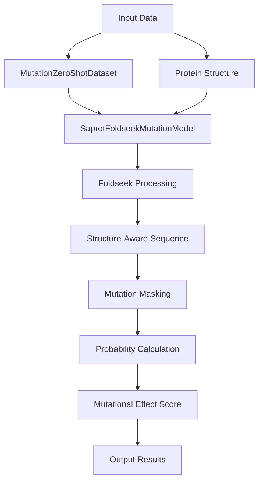

Zero-shot mutational effect prediction enables the assessment of protein mutation impacts without task-specific training, leveraging pre-trained protein language models to evaluate fitness changes directly from sequence and structure information.

## Core Architecture and Workflow

The zero-shot prediction system operates through a sophisticated pipeline that integrates structure-aware protein representations with mutational analysis. The architecture is built around the `SaprotFoldseekMutationModel` [saprot_foldseek_mutation_model.py#L19], which extends the base Saprot model with specialized mutation prediction capabilities.



### Model Components

The prediction system consists of three main components working in concert:

1. **Dataset Handler**: The `MutationZeroShotDataset` [mutation_zeroshot_dataset.py#L9] processes mutation data, extracting sequences, mutation information, and fitness scores from LMDB databases.

2. **Core Model**: The `SaprotFoldseekMutationModel` [saprot_foldseek_mutation_model.py#L19] implements the zero-shot prediction logic using structure-aware representations.

3. **Execution Engine**: The `mutation_zeroshot.py` script [mutation_zeroshot.py#L17] orchestrates the prediction process across multiple datasets.

## Structure-Aware Mutation Analysis

### Foldseek Integration

The system leverages Foldseek to convert 3D protein structures into structure-aware sequences. This process involves:

- **Structure Processing**: Converting PDB/mmCIF files to structural descriptors using the Foldseek binary [saprot_foldseek_mutation_model.py#L96]
- **Quality Filtering**: Applying pLDDT thresholds to mask low-confidence regions [saprot_foldseek_mutation_model.py#L112]
- **Token Integration**: Combining amino acid sequences with structural tokens to create unified representations

> [!TIP]
> The pLDDT threshold (default: 70) is crucial for prediction accuracy. Regions below this threshold are masked to prevent unreliable structural information from influencing predictions.

### Mutation Encoding

Mutations are encoded using a standardized format where each mutation follows the pattern "A123B" (original amino acid, position, mutated amino acid). Multiple mutations are separated by colons. The system handles both substitution and insertion mutations through specialized processing logic [saprot_foldseek_mutation_model.py#L172-L194].

## Prediction Mechanism

### Zero-shot Scoring

The core prediction mechanism computes mutational effects through probability ratio calculations:

```python
pred += torch.log(mut_prob / ori_prob)
```

This formula [saprot_foldseek_mutation_model.py#L270] represents the log-likelihood ratio between mutated and original amino acid probabilities at specific positions, providing a quantitative measure of mutational impact.

### Advanced Features

The system supports several advanced features for enhanced prediction accuracy:

- **MSA Integration**: Optional multiple sequence alignment information can be incorporated to improve predictions [saprot_foldseek_mutation_model.py#L263-L267]
- **Structural Masking**: Random masking of structural tokens for robustness [saprot_foldseek_mutation_model.py#L117-L122]
- **Sequence Substitution**: Random amino acid substitution for data augmentation [saprot_foldseek_mutation_model.py#L147-L152]

## Configuration and Usage

### Benchmark Datasets

The system supports multiple benchmark datasets through standardized configurations:

| Dataset | Configuration File | Key Features |
|---------|-------------------|--------------|
| ProteinGym | `ProteinGym/saprot.yaml` | Substitution mutations, fitness prediction |
| ClinVar | `ClinVar/saprot.yaml` | Clinical variants, evolutionary indices logging |
| Thermostability | `Thermostability/saprot.yaml` | Temperature stability predictions |

> [!TIP]
> The ClinVar configuration includes special logging functionality to save predicted evolutionary indices for clinical variant analysis, supporting downstream medical research applications.

### Model Parameters

Key configuration parameters for zero-shot prediction:

```yaml
model:
  kwargs:
    foldseek_path: /path/to/foldseek
    config_path: westlake-repl/SaProt_35M_AF2
    load_pretrained: True
    plddt_threshold: 70
```

These parameters [ProteinGym/saprot.yaml#L7-L14] control the model's behavior and processing pipeline.

## API Methods

The model provides several convenient methods for mutation prediction:

- **Single Mutation Prediction**: `predict_mut()` [saprot_foldseek_mutation_model.py#L311] for individual mutations
- **Position-Specific Analysis**: `predict_pos_mut()` [saprot_foldseek_mutation_model.py#L351] for comprehensive mutational scanning
- **Probability Distribution**: `predict_pos_prob()` [saprot_foldseek_mutation_model.py#L388] for amino acid probability analysis

## Performance Evaluation

The system evaluates predictions using Spearman correlation coefficients between predicted scores and experimental fitness values. Metrics are computed automatically during testing and logged for analysis [saprot_foldseek_mutation_model.py#L290-L295].

## Next Steps

For comprehensive protein analysis, consider exploring:
- [Protein Inverse Folding](10-protein-inverse-folding) for sequence design applications
- [Multi-model Ensemble Prediction](11-multi-model-ensemble-prediction) for improved accuracy
- [Structure-Aware Sequence Generation](12-structure-aware-sequence-generation) for advanced representation techniques

The zero-shot mutational effect prediction capability represents a powerful tool for protein engineering and variant interpretation, enabling rapid assessment of mutation impacts without extensive training requirements.